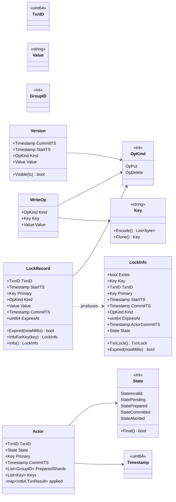
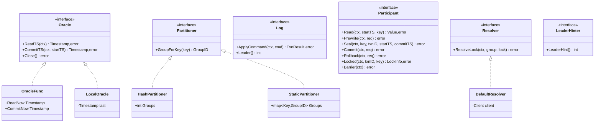
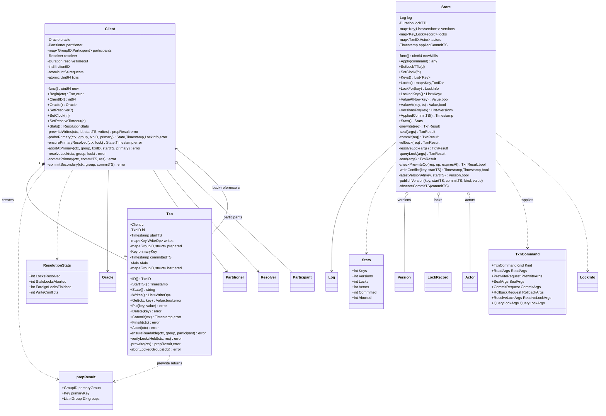
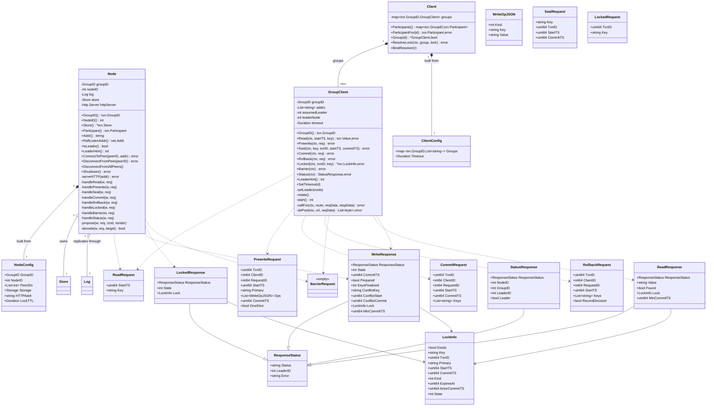
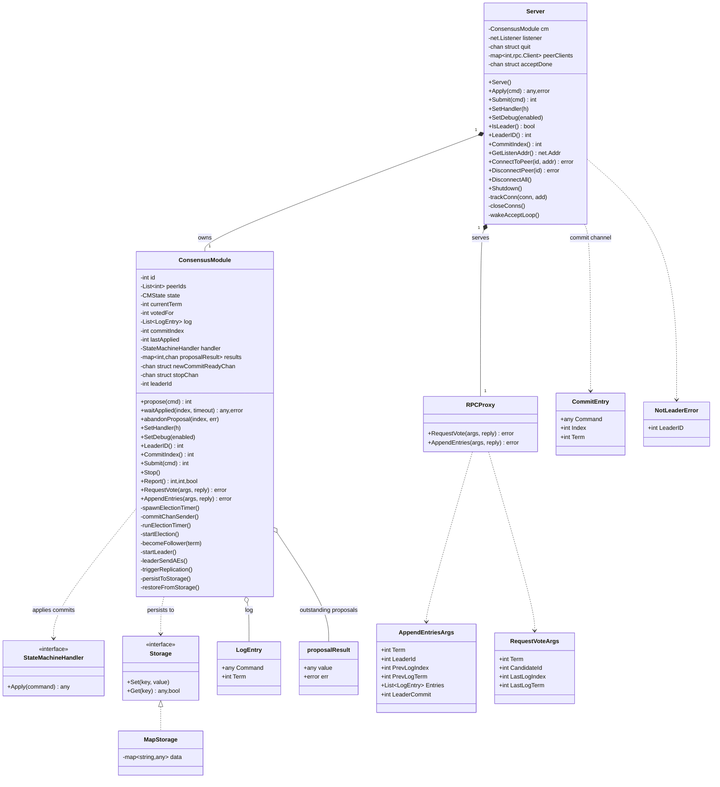
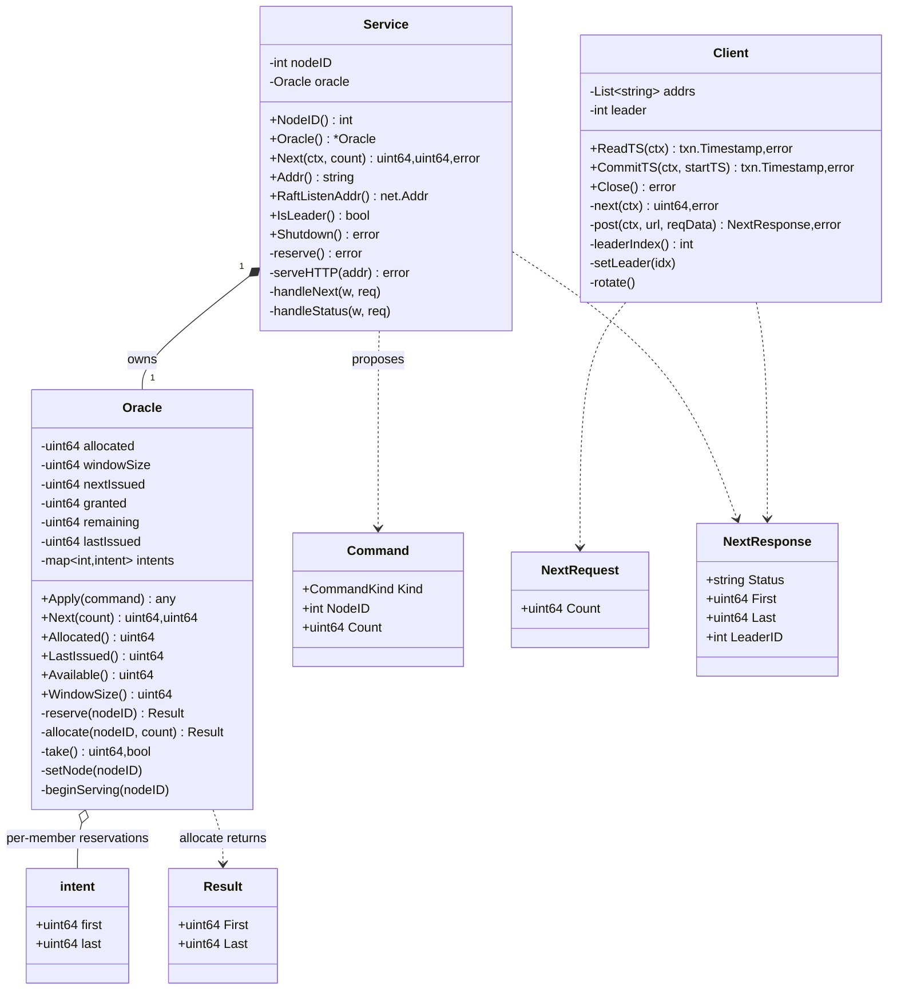
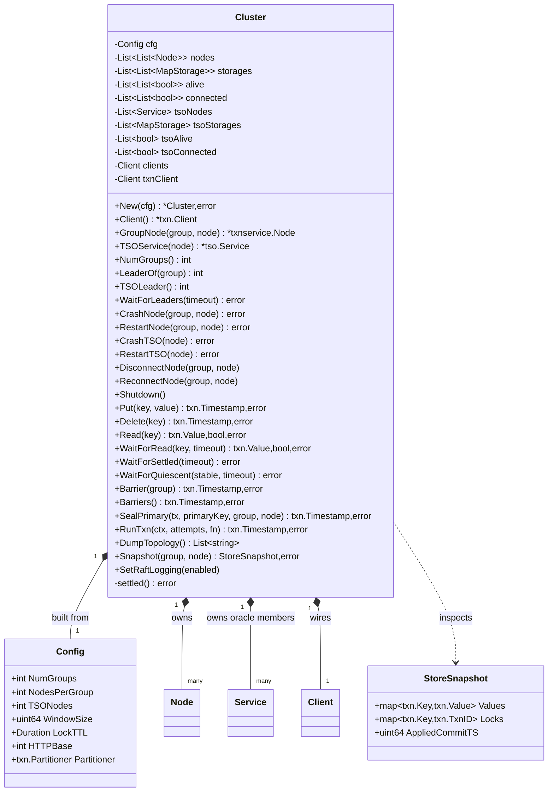
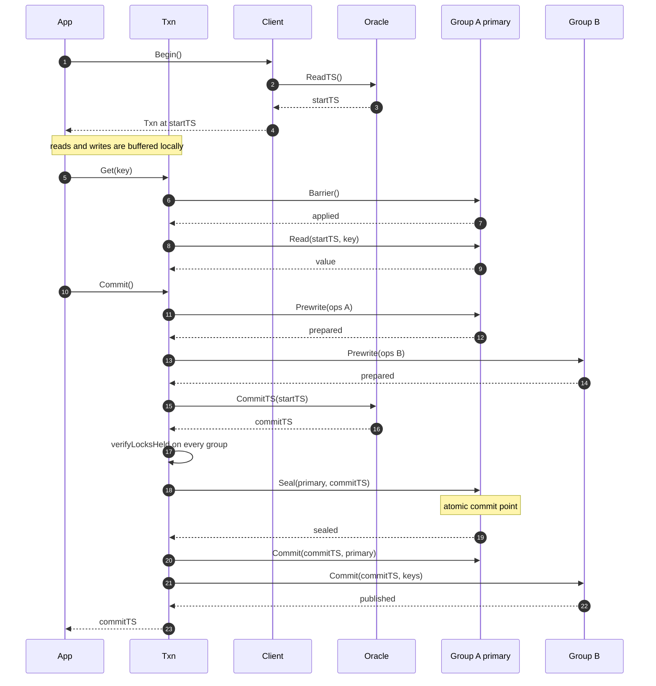

# 04 — Architecture: UML class diagrams

> 中文版：[`04-uml-class-diagram.zh-CN.md`](04-uml-class-diagram.zh-CN.md)

This document is the structural companion to docs/01–03. Those explain *why* the
system is built the way it is; this one shows *what the parts are and how they fit
together*.

Every type, field and relationship below was read out of the source rather than
recalled, and every diagram is validated: a script checks that the mermaid blocks
parse, that no class name is invented, and that no method name is invented. See §9
for exactly what that covers and what it does not.

Layer boundaries are the package boundaries, which are also the dependency
direction: nothing in a lower layer imports a higher one.

## 1. Layers and dependencies

```
                     cmd/demo            cluster
                        |                  |
                        +--------+---------+
                                 v
                          txnservice ------> txn
                                 |             ^
                                 v             |
                          internal/raft        |
                                               |
                              tso -------------+
                    (tso imports txn only for Timestamp and Command)
```

Read it as: the transaction protocol (`txn`) is the centre. It defines every
interface, and every other package either implements one of those interfaces
(`txnservice`, `internal/raft`, `tso`) or wires implementations together
(`cluster`, `cmd/demo`). `txn` imports nothing else from this repository except
`internal/raft`, and only in `raftadapter.go`, to adapt a `*raft.Server` into the
`Log` and `Participant` interfaces.

## 2. Core vocabulary — `package txn`

The shared types every other layer speaks in. These are the names that recur in the
protocol diagrams below.



**Why these records are separate.** `Version` is history: a chain of them per key is
the MVCC store. `LockRecord` is the in-flight write, holding a version back until
the transaction decides. `Actor` is the transaction's own state *as one group sees
it*, and it is what a reader consults to learn whether a lock it tripped over
belongs to a live, committed or dead transaction. `LockRecord.CommitTS` answers that
for one key; `Actor` answers it for the whole transaction, which is what a reader of
a *secondary* lock needs.

## 3. The transaction protocol — `package txn`

Interfaces are the contract; the concrete types below them are the implementations,
which live in other packages.



`Participant` is the RPC surface of one Raft group, and it is the most important
interface here: it is implemented twice (over HTTP in §5, in-process in §6), and the
coordinator is written against the interface so both work unchanged. `Log` is the
narrower thing the *state machine* needs: replicate a command, and ask who leads.

`DefaultResolver` is the recovery policy. Given a lock found in some group, it works
out the owning transaction's fate from its **primary** group and then either
finishes the write or discards it. It holds a `*Client` because it reuses the
coordinator's probing machinery, which is why the two are bound to each other after
construction rather than passed in.

## 4. The coordinator and the state machine



`Client` holds no per-transaction state and is safe for concurrent use; `Txn` holds
all of it and is explicitly **not** safe for concurrent use. That split is why one
`Client` serves many transactions.

`Store` is the replicated state machine. `Apply` is its only entry point: every
mutation arrives as a `TxnCommand` that Raft has already ordered, so the state
machine never sees two concurrent writers and needs no internal locking of its own.

## 5. The service layer — `package txnservice`

How a group is reached over HTTP, and how a group member is assembled from
consensus, a state machine, and an HTTP surface.



`Node` and `GroupClient` are the two ends of one wire protocol: the `*Request` types
are what `GroupClient` sends and what `Node.handle*` decodes, and the `*Response`
types are what the handler writes and the client parses. Every response embeds
`ResponseStatus`, so a client can recognise `not-leader` and follow the hint without
knowing which handler answered.

## 6. Consensus and the timestamp oracle



`StateMachineHandler` is the seam between consensus and the transaction layer:
`txn.Store.Apply` is what gets installed, so a committed log entry *is* a
transactional state-machine command. `Server.Apply` is the synchronous path built on
top — propose, then wait for the applier to hand back a result — which is the local
extension that lets a coordinator get an answer instead of merely a log index.

The timestamp oracle reuses the same consensus module with its own state machine:



The oracle's `intents` map is the part worth noticing. Each member *reserves* a
window of timestamps and may spend only from its own reservation. That is what makes
a leader change safe: a new leader cannot spend its predecessor's window, because
the reservations are part of the replicated state. Timestamps may therefore be
wasted, but never repeated.

## 7. Test harness — `package cluster`

Not production code, but part of the architecture: it is how everything above is
exercised and how the demo is run.



## 8. The commit path, as a sequence

Class diagrams show structure; this shows the order the structure is used in, for
one cross-group transaction.



The line that matters most is `Seal(primary, commitTS)`. Until it lands the
transaction can still be aborted; once it lands, any reader that trips over one of
the transaction's locks can learn the outcome and finish the write without the
coordinator's help.

## 9. How these diagrams were validated

Diagrams are easy to get subtly wrong, and a diagram that does not render documents
nothing. Three mechanical checks were run, and they are worth stating precisely
because they also bound what this document claims.

**1. The mermaid blocks parse.** A script checks each `classDiagram` and
`sequenceDiagram` block against its structural rules: the diagram keyword first,
balanced class bodies, every member line matching one of mermaid's member forms, and
every relationship using a real operator. It is stricter than mermaid on purpose —
it reports unrecognised lines rather than skipping them — because mermaid renders an
error box where a strict check fails loudly.

This caught 32 real problems in the first draft. Two kinds:

* **Go slice syntax is not mermaid.** I had written `+[]Key Keys` and
  `+Writes() []WriteOp`. Mermaid's grammar has no `[]` member form; the idiomatic
  spelling is `List~Key~`, which is what the diagrams now use.
* **Prose is not a member.** A class body may contain members and stereotypes, not
  an explanatory sentence. That text moved out into the surrounding document.

**2. No class name is invented.** Every node in every diagram was extracted and
checked against `^type X` across all non-test `.go` files: 71 nodes, against 105
types in the code, all found. The only names not in the code are the three
sequence-diagram outer participants (`App`, `GA`, `GB`), which are deliberately one
level above the classes.

**3. No method name is invented.** Every member containing parentheses was extracted
and matched against `func ... Name(` in the sources: 171 method names checked. This
found one genuine fabrication — a `SetHandlerHint` on `Store` that does not exist —
which has been removed.

**What these checks do not cover.** They cannot confirm a diagram *reads* well, that
the chosen relationships are the most illuminating ones, or that a listed member is
the most important one. They also cannot render: this environment has no network and
no mermaid installed, so rendering was replaced by grammar validation. If you have
mermaid available, `mmdc -i docs/04-uml-class-diagram.md -o /tmp/out.md` renders all
eight blocks. If it disagrees with anything above, believe `mmdc` and the source, not
this document.

Checks 1 is reproducible from the repository:

```sh
node tools/doc-check/check-mermaid.js docs/04-uml-class-diagram.md
```

It takes a markdown file, validates every fenced `mermaid` block, and exits non-zero
on the first problem it can describe. It is a grammar check, not a renderer: it
knows the member and relationship forms of `classDiagram` and `sequenceDiagram`, and
nothing else. Checks 2 and 3 were ad-hoc greps over the sources and are not shipped,
because they depend on this document's particular naming.

One accuracy note the diagrams expose. `Version.Visible` uses `<=`, whereas
docs/02-transaction-design.md §7.4 requires visibility to be `CommitTS < snapshot`.
The two are not in conflict: `Store.latestVersionAt` is the function reads actually
go through, and it uses `<`. `Version.Visible` is a leftover helper the read path
does not call, so §2 shows it as part of the type but it is not drawn as part of the
read path.
