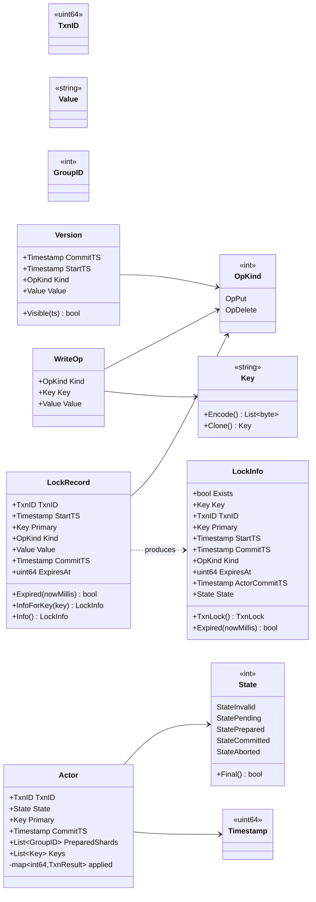
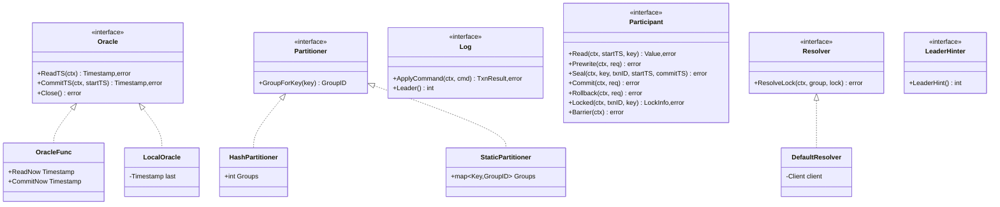
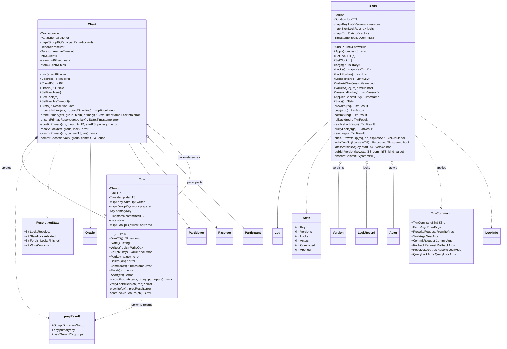
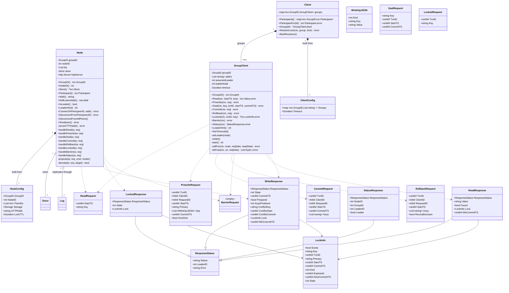
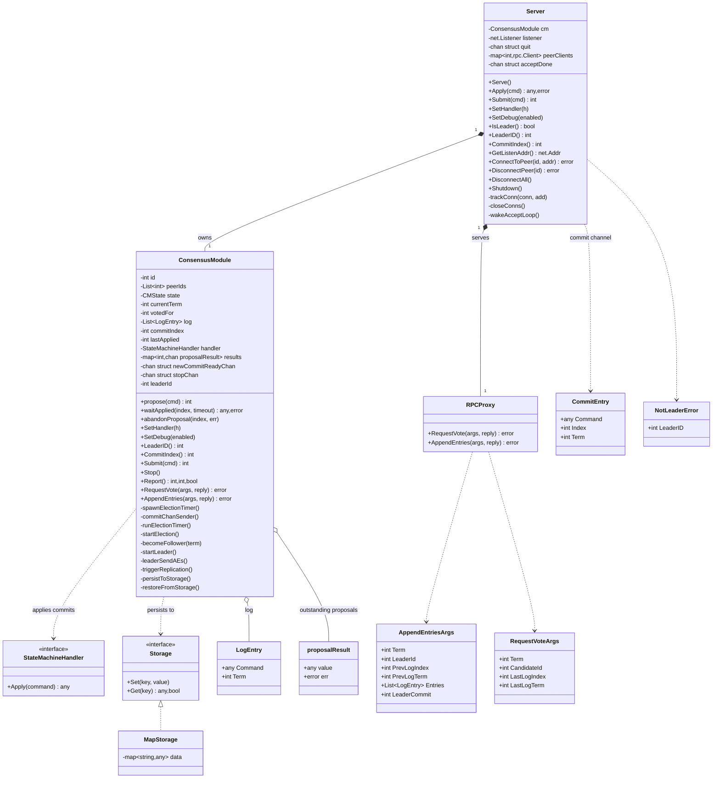
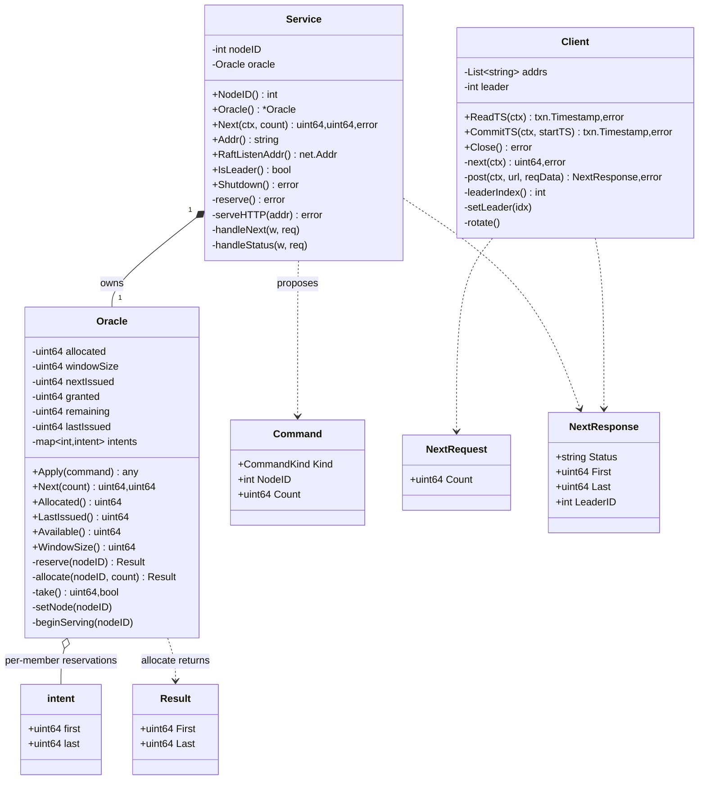
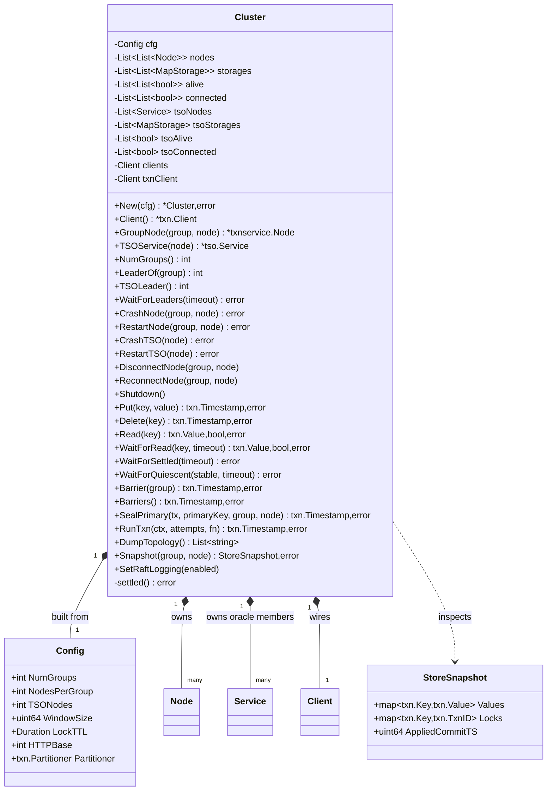
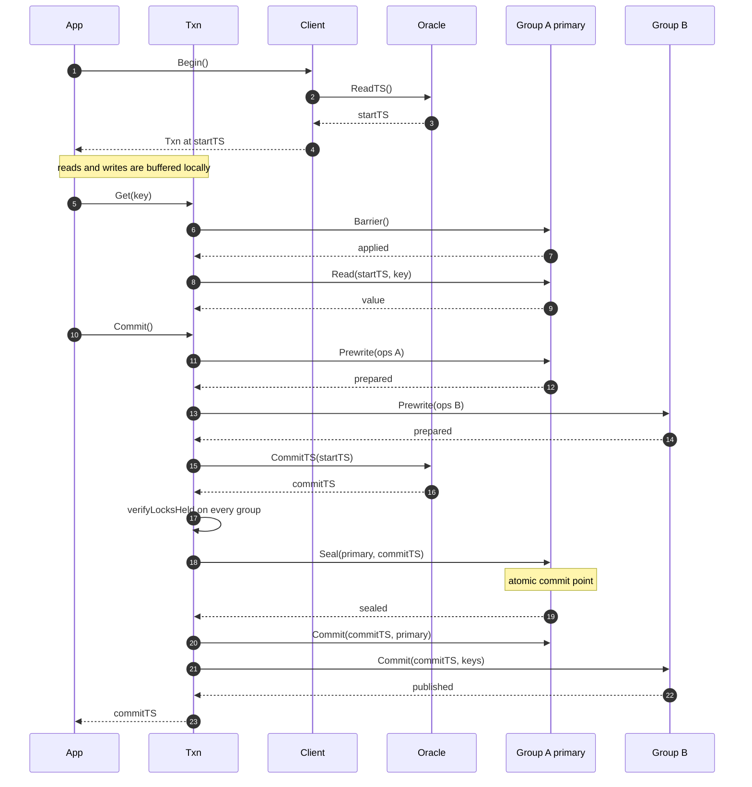

# 04 —— 架构：UML 类图

> English version: [04-uml-class-diagram.md](04-uml-class-diagram.md)

本文档是 docs/01–03 的结构性姊妹篇。那几篇解释系统*为什么*要建成现在这样；这一篇展示
*各个部件是什么，以及它们如何拼合在一起*。

下文的每一个类型、字段和关系都是从源码中读出来的，而不是凭记忆写下的；每一张图都经过
校验：有一个脚本会检查 mermaid 块能否解析、有没有类名是臆造的、有没有方法名是臆造的。
§9 精确说明了这一校验覆盖了什么、又没有覆盖什么。

层的边界就是包的边界，而包边界也正是依赖方向：低层中的任何东西都不会导入更高层。

## 1. 层与依赖

```
                     cmd/demo            cluster
                        |                  |
                        +--------+---------+
                                 v
                          txnservice ------> txn
                                 |             ^
                                 v             |
                          internal/raft        |
                                               |
                              tso -------------+
                    (tso imports txn only for Timestamp and Command)
```

这样读它：事务协议（`txn`）居于中心。它定义了每一个接口，而其他每个包要么实现其中一个
接口（`txnservice`、`internal/raft`、`tso`），要么把各个实现装配到一起（`cluster`、
`cmd/demo`）。`txn` 不从这个仓库中导入任何其他东西，唯一的例外是 `internal/raft`，而且
只出现在 `raftadapter.go` 里，用于把一个 `*raft.Server` 适配成 `Log` 与 `Participant`
接口。

## 2. 核心词汇 —— `package txn`

其他每一层都用这些共享类型来「说话」。下面这些名字会在后面的协议图中反复出现。



**为什么这些记录是彼此分开的。** `Version` 是历史：每个键上的一条版本链就构成了 MVCC
存储。`LockRecord` 是进行中的写入，它把一个版本扣住，直到事务作出裁决。`Actor` 是事务
自身的状态*在某个组看来*的样子，读者正是通过它来弄清自己撞上的一个锁属于一个存活的、
已提交的还是一个已死亡的事务。`LockRecord.CommitTS` 针对单个键回答这个问题；`Actor`
则针对整个事务回答它，而这正是*从*锁的读者所需要的。

## 3. 事务协议 —— `package txn`

接口就是契约；接口之下的那些具体类型就是实现，它们位于其他包中。



`Participant` 是单个 Raft 组的 RPC 表面，也是这里最重要的接口：它有两个实现（§5 中基于
HTTP，§6 中进程内），而协调器是针对这个接口编写的，因此两者都无需改动即可工作。`Log`
是*状态机*所需的那个更窄的东西：复制一条命令，并询问谁是领导者。

`DefaultResolver` 是恢复策略。给定在某个组中发现的一个锁，它会依据该事务的**主键**所在
组判明持有该锁的事务的最终命运，然后要么把这次写入完成，要么丢弃它。它持有一个
`*Client`，因为它复用了协调器的探测机制；这也是为什么二者在构造完成之后相互绑定，而
不是作为参数传入。

## 4. 协调器与状态机



`Client` 不持有任何按事务划分的状态，可安全地并发使用；`Txn` 持有全部这类状态，并且
明确**不**可安全地并发使用。正是这一划分使得一个 `Client` 可以服务多个事务。

`Store` 就是那个复制状态机。`Apply` 是它唯一的入口：每一次变更都以一条 `TxnCommand`
的形式到达，而这条命令已经由 Raft 排好序，因此状态机永远不会同时面对两个写者，它自身
也不需要任何内部加锁。

## 5. 服务层 —— `package txnservice`

一个组如何通过 HTTP 被访问，以及一个组成员如何由共识、状态机和一层 HTTP 表面装配而成。



`Node` 与 `GroupClient` 是同一个线上协议的两端：`*Request` 类型是 `GroupClient` 发送、
`Node.handle*` 解码的东西，`*Response` 类型则是处理器写出的、客户端解析的东西。每个响应
都内嵌了 `ResponseStatus`，因此客户端能够识别 `not-leader` 并顺着其中的提示走，而不必
知道究竟是哪一个处理器作出的应答。

## 6. 共识与授时服务



`StateMachineHandler` 是共识与事务层之间的接缝：被安装进去的正是 `txn.Store.Apply`，
因此一条已提交的日志条目*就是*一条事务状态机命令。`Server.Apply` 是构建在其上的同步
路径 —— 先提议，然后等待应用器交回一个结果 —— 它是本地的一处扩展，让协调器能够得到
一个答案，而不仅仅是一个日志下标。

授时服务复用同一个共识模块，但配有自己的状态机：



授时服务里值得注意的部分是那个 `intents` 映射。每个成员都*预留*一个时间戳窗口，并且
只能花用自己预留的那一份。这正是领导者更替之所以安全的原因：新的领导者无法花用前一任
领导者的窗口，因为这些预留是复制状态的一部分。因此时间戳可能被浪费，但绝不会被重复。

## 7. 测试装置 —— `package cluster`

它不是产品代码，但却是架构的一部分：上面的一切都靠它来演练，演示程序也靠它来运行。



## 8. 提交路径的时序图表示

类图展示的是结构；这张图展示的则是结构在一次跨组事务中被使用的顺序。



最重要的一行是 `Seal(primary, commitTS)`。在它落定之前，事务仍然可以被中止；一旦它
落定，任何一个撞上该事务某个锁的读者都能得知最终结果，并在没有协调器帮助的情况下把
这次写入完成。

## 9. 这些图是如何校验的

图很容易在细微之处出错，而一张渲染不出来的图什么也说明不了。我们运行了三项机械检查，
它们值得被精确地陈述出来，因为它们同时也界定了本文档所主张的范围。

**1. mermaid 块能够解析。** 有一个脚本会按结构规则检查每一个 `classDiagram` 和
`sequenceDiagram` 块：图关键字必须位于最前，类体必须配平，每一行成员都必须匹配
mermaid 的某一种成员形式，每一条关系都必须使用真实存在的运算符。它有意比 mermaid 更
严格 —— 它会报告无法识别的行，而不是跳过它们 —— 因为在 mermaid 渲染出一个错误框的
地方，严格的检查会大声报错。

这在初稿中抓出了 32 个真实问题。分两类：

* **Go 的切片语法不是 mermaid。** 我原来写的是 `+[]Key Keys` 和
  `+Writes() []WriteOp`。mermaid 的文法里没有 `[]` 这种成员形式；惯用的写法是
  `List~Key~`，这也是现在这些图所采用的写法。
* **散文不是成员。** 类体中只能包含成员和构造型，不能包含一个解释性的句子。那些文字
  被移到了周围的正文里。

**2. 没有类名是臆造的。** 每一张图中的每一个节点都被提取出来，并与所有非测试 `.go`
文件中的 `^type X` 逐一核对：71 个节点，对应代码中的 105 个类型，全部找到。代码中不
存在的名字只有时序图里的三个外层参与者（`App`、`GA`、`GB`），它们被有意放在比类高一层
的位置上。

**3. 没有方法名是臆造的。** 每一个含有括号的成员都被提取出来，并与源码中的
`func ... Name(` 逐一匹配：共检查了 171 个方法名。这一步发现了一处货真价实的凭空捏造
—— `Store` 上一个并不存在的 `SetHandlerHint` —— 它已经被移除。

**这些检查没有覆盖什么。** 它们无法确认一张图*读起来*是否顺畅、所选的关系是否是最能
说明问题的那些、或者所列出的成员是否就是最重要的那个。它们也无法渲染：这个环境没有
网络，也没有安装 mermaid，因此渲染被文法校验替代了。如果你手边有 mermaid，
`mmdc -i docs/04-uml-class-diagram.md -o /tmp/out.md` 可以渲染全部八个块。如果它的结果
与上文有任何不一致，请相信 `mmdc` 和源码，而不是本文档。

检查 1 可以从仓库中复现：

```sh
node tools/doc-check/check-mermaid.js docs/04-uml-class-diagram.md
```

它接收一个 markdown 文件，校验其中每一个围栏化的 `mermaid` 块，并在遇到第一个它能描述
的问题时以非零状态退出。它是一次文法检查，而不是渲染器：它认得 `classDiagram` 和
`sequenceDiagram` 的成员形式与关系形式，别的就一概不知了。检查 2 和检查 3 是对源码做的
临时 grep，并未随仓库提供，因为它们依赖于本文档特有的命名。

还有一处准确性问题，是这些图暴露出来的。`Version.Visible` 用的是 `<=`，而
docs/02-transaction-design.md §7.4 要求可见性判定为 `CommitTS < snapshot`。两者并不
冲突：读操作实际走的是 `Store.latestVersionAt` 这个函数，它用的是 `<`。`Version.Visible`
是一个遗留的辅助方法，读路径并不调用它，因此 §2 把它作为类型的一部分展示出来，但没有
把它画成读路径的一部分。
