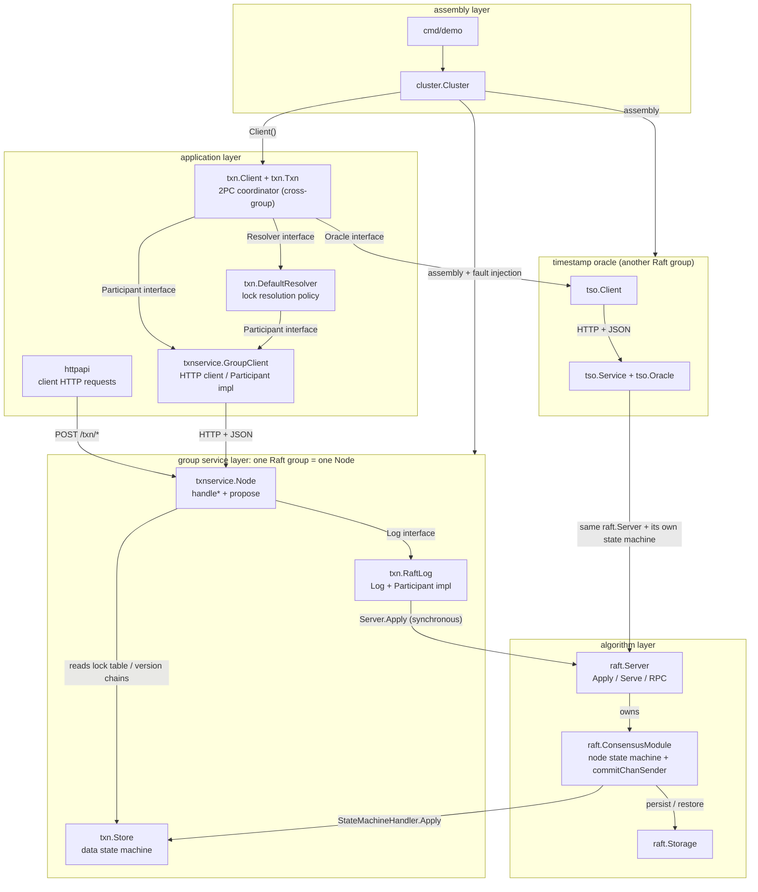
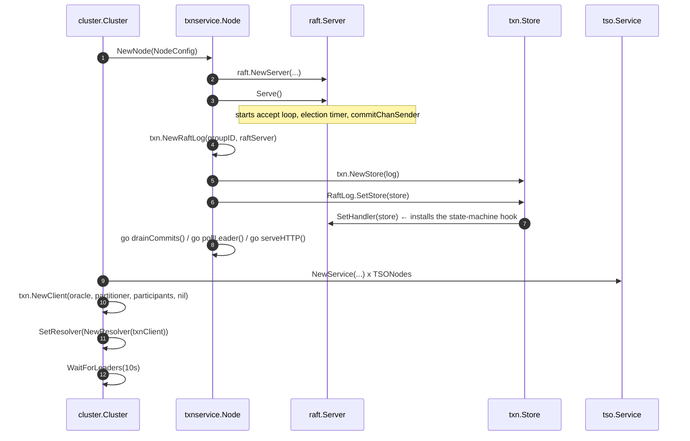
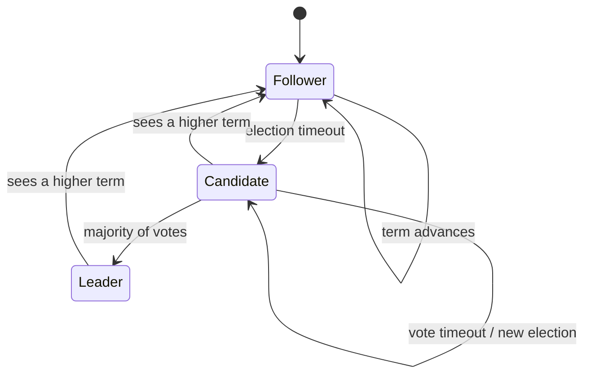
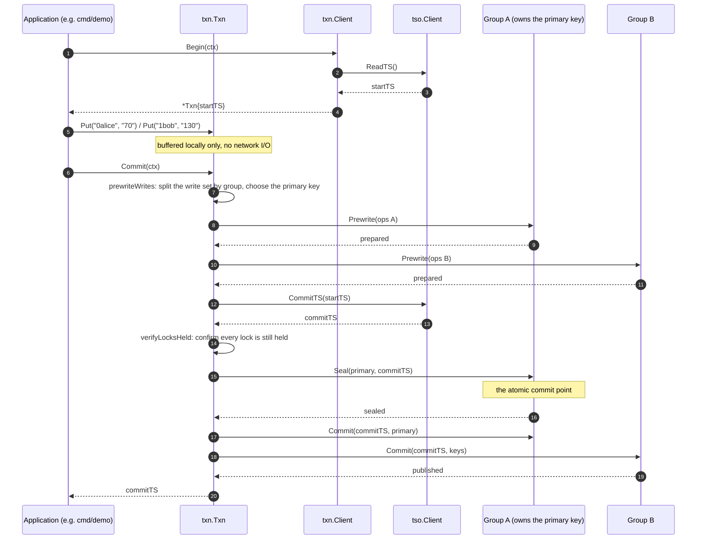

# 05 — Workflow analysis: by module association

> 中文版：[`05-workflow-analysis.zh-CN.md`](05-workflow-analysis.zh-CN.md)

This document is a workflow analysis of the codebase **organised by module
association**. It does not repeat the design rationale — that is the job of
[`docs/02-transaction-design.md`](02-transaction-design.md); this document answers
only three questions:

1. What **modules** the code is split into, and where each module's responsibility
   boundary lies;
2. **Through what associations** modules relate to each other (calls, channels,
   interface implementations, HTTP);
3. When one request travels through the whole system, **in what order those
   associations are used**.

The analytical method follows an article that walks through the source of etcd's raft
implementation (referred to below as **the reference article**): it first gives a
glossary and a macro architecture, then breaks the core data structures down layer by
layer, then focuses on the **cross-layer interaction flows**, and finally splits the
write flow and the read flow into numbered steps, each one saying outright "which
module → calls what → which data structure crossed the boundary". This document
reuses that skeleton, and at every key point calls out **the structural differences
between this repository and etcd** — those differences are exactly where the design
of this code lies.

---

## 0 Preface

The reference article analyses the raft implementation in etcd v3.1.10: etcd splits
raft into an **algorithm layer** (`./raft/*`, an SDK that can be imported on its own)
and an **application layer** (`contrib/raftexample/*`). The two layers each run in
their own goroutines, communicate asynchronously over a handful of channels, and use
`Ready`/`Advance` as the boundary of one round of interaction.

This repository faces the same structural problem but answers it differently. **That
difference is the key to understanding this codebase**:

| Concern | etcd (the reference article) | This repository |
|---|---|---|
| Boundary between the algorithm layer and the transaction layer | etcd's raft is a general-purpose consensus library | `internal/raft` is likewise a general-purpose consensus library, but **adds one state-machine hook** (`StateMachineHandler`) |
| Communication between the application layer and the algorithm layer | a few channels (`propc`/`recvc`/`readyc`/`advancec`) + the `Ready`/`Advance` protocol, **asynchronous** | `Server.Apply`: propose + wait, **synchronous**. That `Ready`/`Advance` protocol layer was removed in the local extensions |
| What drives the timer | the application layer calls `Node.Tick()` on a ticker | the election timer inside `ConsensusModule` keeps its own time; there is no external Tick |
| Who applies the state machine | the application layer reads committed entries from `commitChan` and applies them itself | **`commitChanSender` applies them directly on the commit path**; the application layer only drains the channel |
| Cross-group transactions | a single group in etcd (the v3.1 era); transactions live elsewhere | the `txn` layer does the 2PC coordination for Multi-Raft; `txnservice` serves **one group** only |

The sections below unfold this point by point.

---

## 1 Module breakdown

The raft-related code is distributed as follows. **The "layer" column is the
coordinate system for everything that follows in this document.**

| Module | Directory | Layer | Responsibility |
|---|---|---|---|
| Consensus algorithm layer | `internal/raft/*` | algorithm layer | Raft itself: elections, log replication, persistence, RPC transport. Upstream `part3/raft` plus a few additions marked "local extension" |
| Group service layer | `txnservice/*` | application layer | Assembles **one** Raft group into a remotely accessible service: algorithm layer + transaction state machine + HTTP interface |
| Transaction protocol layer | `txn/*` | application layer (protocol) | MVCC state machine, intent locks, the 2PC coordinator, lock resolution policy. **Defines every interface** |
| Timestamp oracle | `tso/*` | application layer (its own consensus group) | A Raft-replicated timestamp oracle, likewise running on top of the algorithm layer |
| Cluster assembly | `cluster/*` | assembly layer | Assembles several groups and several oracle members into one Multi-Raft cluster, and provides fault injection |
| Demo program | `cmd/demo/*` | assembly layer | A runnable end-to-end demonstration |

**The key structural fact: `txn` defines the interfaces, and other modules implement
them.** That lets the same coordination logic run both over HTTP (the production
path) and in-process (tests and `cluster`). §3 expands on this.

---

## 2 Glossary

The reference article's practice of fixing terminology up front is well worth
copying: in this codebase "layer", "state machine" and "commit" each have two
meanings, and unless they are settled first the rest is bound to be ambiguous.

| Term | English name / code identifier | Notes |
|---|---|---|
| algorithm layer | algorithm layer / `internal/raft` | The module that encapsulates the Raft consensus mechanism. Imported by the layers above as a library; **it is unaware of transactions, key-values and HTTP** |
| application layer | application layer | The module that brings together storage, communication and HTTP capability. It links the two directions: it serves clients outward and uses the algorithm layer inward |
| group service | group service / `txnservice.Node` | The abstraction of "one Raft group" within the application layer. It holds the algorithm layer's `*raft.Server` and the transaction state machine `*txn.Store`, and exposes HTTP |
| coordinator | coordinator / `txn.Client` | The initiator of the cross-group 2PC. It is **not** a Raft node itself; it is a piece of client-side logic |
| transaction handle | transaction handle / `txn.Txn` | All the local state of one transaction (start timestamp, write set, prepared groups). `Client` holds no transaction state, so it can be reused concurrently |
| data state machine | data state machine / `txn.Store` | The medium that actually stores the data: version chains + lock table + transaction records. To avoid confusion with the "Raft node state machine", this document always calls it the **data state machine** |
| node state machine | node state machine / `ConsensusModule` | A Raft node is itself a state machine: any input (an election timeout, an inbound RPC, a proposed command) drives a change of state |
| proposal | proposal / `ConsensusModule.propose` | The first stage of the two-stage commit: append the command to the log |
| commit | commit / `commitIndex` advancing | The second stage: the log entry has been replicated to a majority and may take effect externally |
| apply | apply / `StateMachineHandler.Apply` | Feed committed log entries to the data state machine, so that a write request actually takes effect |
| barrier | barrier / `CmdBarrier` | A **no-op** log entry whose only meaning is its position in the log: waiting for it to be applied proves that every entry before it has been applied |
| seal | seal / `CmdSeal` | Write the commit timestamp into the **primary key**'s lock record, but **do not** publish a version. **Sealing the primary key is the transaction's atomic commit point** |
| primary / secondary key | primary / secondary key | One distributed lock table. The primary key carries the transaction's commit decision; a secondary key can only go and ask the primary |
| lease | lease / `LockRecord.ExpiresAt` | The lifetime of a lock, which bounds how long a reader waits; **it does not authorise a rollback** (see §7.5) |
| resolution | resolution / `Client.resolveLock` | When a reader trips over a lock someone else left behind, it determines that transaction's fate and publishes or discards accordingly |
| timestamp oracle | timestamp oracle / `tso` | The source of globally monotonic, unique timestamps; itself a Raft group |
| start timestamp | start timestamp / `Txn.startTS` | The consistency viewpoint a transaction reads at |
| commit timestamp | commit timestamp / `Txn.committedTS` | The point in time at which a transaction's writes become externally visible |

---

## 3 Macro architecture

### 3.1 The algorithm layer

The algorithm layer is the core implementation of the Raft consensus mechanism: terms
and voting, log replication, persistence, RPC transport. It has exactly three kinds
of **input**: a peer RPC that arrives, a command proposed locally, and the election
timer expiring.

The most important extension this repository makes to the algorithm layer is the
introduction of a **state-machine hook**:

```
StateMachineHandler.Apply(command any) any
```

Upstream `part3/raft` has no such concept — upstream hands committed entries to the
application layer, and the application layer decides for itself how to apply them.
This repository makes **the group itself the state machine**: after `Server.Apply`
proposes a command, it waits for `commitChanSender` to finish applying that entry, and
then returns the data state machine's answer back along the same path to the proposer.

This has two consequences, and they are the premise for understanding every flow that
follows:

1. **A proposal can be synchronous.** When the coordinator calls
   `Participant.Prewrite`, what it gets back is not a log index but the data state
   machine's verdict on that prewrite (success / conflict / lock held). There is no
   second mechanism for "correlating a result with a log index".
2. **Apply must happen outside the consensus lock.** `commitChanSender` releases
   `cm.mu` before calling `handler.Apply`; otherwise the data state machine's own
   lock would form a cycle with the consensus lock, and one slow apply would hold up
   elections and heartbeats.

### 3.2 The group service layer

`txnservice.Node` is the assembly that sits on top of the algorithm layer; it turns
one Raft group into a remotely accessible service:

```
        HTTP client (txnservice.GroupClient)
                    │  POST /txn/prewrite/ etc.
                    ▼
        ┌───────────────────────────────────────────┐
        │  Node (one Raft group)                     │
        │   httpServer  ──> handlePrewrite ...       │  application layer: protocol & transport
        │        │ propose(cmd, render)              │
        │        ▼                                   │
        │   RaftLog.ApplyCommand ──> Server.Apply    │  ← the inter-layer boundary
        │        │                                   │
        │   raft.Server / ConsensusModule            │  algorithm layer: consensus
        │        │ commitChanSender: handler.Apply   │  ← the state-machine hook
        │        ▼                                   │
        │   txn.Store (data state machine)           │  application layer: MVCC + locks
        └───────────────────────────────────────────┘
```

Note the `commitChan` inside `Node`: the algorithm layer still sends committed entries
to it, but **it no longer drives the state machine** (the state machine has already
been applied on the synchronous path). The `Node.drainCommits` goroutine exists only
to drain the channel; otherwise the algorithm layer's commit sender would block. This
is the structural leftover that necessarily appears once "synchronous `Apply` replaces
`Ready`/`Advance`", and it is the most direct contrast with etcd.

### 3.3 Macro architecture: what connects the modules

This is the most important diagram in the document. It marks every module, and **what
actually sits on each edge between modules**:



**How to read it**: the label on a solid edge is the **type** of that association.
Three clear patterns emerge:

1. **`txn` only defines interfaces; it implements no transport.** `Participant`,
   `Log`, `Oracle`, `Resolver` and `Partitioner` are all defined in the `txn`
   package; `txnservice`, `tso` and `internal/raft` each implement one of them.
2. **The algorithm layer connects to the outside world through exactly two
   openings**: inbound `Server.Apply` and outbound `StateMachineHandler.Apply`. The
   algorithm layer does not know that transactions, keys or HTTP exist.
3. **Everything cross-group happens in the coordinator, not in any Raft group.**
   Each Raft group serves only its own slice of the key space; the 2PC orchestration
   lives entirely in the client-side logic of `txn.Client`.

---

## 4 Core data structures of the algorithm layer

This section introduces them one by one, in the manner of the reference article. A
reader who meets an unclear structure in the flow sections later can come back here.

### 4.1 LogEntry / CommitEntry

```go
// internal/raft/raft.go
type LogEntry struct {
    Command any
    Term    int
}

type CommitEntry struct {
    Command any
    Index   int
    Term    int
}
```

One `LogEntry` is one write-ahead log record. Note that `Command` is `any`: the
algorithm layer **does not care** whether what is inside is a transaction command or
something else, and that is exactly why it can be reused (and reused by `tso`).
`CommitEntry` is the same log record after it becomes "committed", with an extra
`Index`, because it has to be sent up to the layer above so that the entry can be
located.

In this repository the log index starts at 0, and `LogEntry` has no separate `Index`
field — the index is its position in the slice. That is how upstream does it, and
this repository has not changed it.

### 4.2 Server

```go
// internal/raft/server.go
type Server struct {
    serverId    int
    peerIds     []int
    cm          *ConsensusModule   // the algorithm core
    storage     Storage
    ready       <-chan any
    commitChan  chan<- CommitEntry
    rpcServer   *rpc.Server
    rpcProxy    *RPCProxy
    listener    net.Listener
    peerClients map[int]*rpc.Client
    conns       map[net.Conn]struct{}   // local extension: used by Shutdown
    quit        chan any
    acceptDone  chan struct{}           // local extension: waits for the accept loop to exit
    wg          sync.WaitGroup
    mu          sync.Mutex
}
```

`Server` is a wrapper around **transport + lifecycle**; the consensus algorithm itself
lives entirely in `ConsensusModule`. `Server` does three things: it listens on TCP and
provides peer-to-peer communication with `net/rpc`; it manages the outbound
`*rpc.Client` for each peer; and it translates "local calls" such as
`Apply`/`Shutdown` into operations on `ConsensusModule`.

`conns` and `acceptDone` are additions in this repository: upstream's `Shutdown` waits
on handler functions that may block forever reading from a peer, which very easily
hangs when several nodes stop at the same time.

### 4.3 ConsensusModule (the node state machine)

```go
// internal/raft/raft.go
type ConsensusModule struct {
    id        int
    peerIds   []int
    state     CMState          // Follower | Candidate | Leader | Dead
    currentTerm int
    votedFor    int

    log         []LogEntry
    commitIndex int
    lastApplied int

    // local extension: the state-machine hook
    handler StateMachineHandler

    // local extension: the correlation table for synchronous proposals
    results map[int]chan proposalResult

    // local extension: wakeup and shutdown
    newCommitReadyChan   chan struct{}
    newCommitReadyChanWg sync.WaitGroup
    stopChan             chan struct{}
    electionTimerWg      sync.WaitGroup

    leaderId int   // local extension: points clients at the leader
    // ... election timer, peer progress, etc.
}
```

The reference article says that an etcd raft node is essentially one big state machine,
and that every operation ends up encapsulated as a message fed into it. **This
repository is not shaped that way**: there is no unified `Step(Message)` entry point,
and no role-dispatched `stepLeader`/`stepCandidate`/`stepFollower`. Instead there are
three distinct entry points:

| Entry point | Trigger | Effect |
|---|---|---|
| `Server.Apply(cmd)` | a local proposal (an HTTP request) | `propose` appends to the log → wakes replication; registers the result channel; waits for the result |
| `RPCProxy.RequestVote/AppendEntries` | a remote peer | enters the corresponding `ConsensusModule` method |
| `runElectionTimer` | the internal timer | on timeout, starts an election |

This is the most fundamental structural difference from etcd, and the reason this
repository's code is small: **it does not need one general-purpose `Message` structure
to cover every scenario**. (The reference article also criticises etcd's
all-encompassing `Message` for breaking the single-responsibility principle; this
repository effectively sidesteps that with three purpose-built entry points, at the
cost of not having etcd's extensibility.)

`results` is the key to synchronous proposals: `map[log index]result channel`. The
proposer registers its own channel, and the applier delivers the result after applying
that entry.

### 4.4 StateMachineHandler (the one outbound interface between layers)

```go
// internal/raft/raft.go
type StateMachineHandler interface {
    Apply(command any) any
}
```

An interface with a single method, yet it is the pivot of the whole architecture: it
is the algorithm layer's **only** data outlet. `txn.Store` implements it, so the
"consensus layer" and the "transaction layer" are decoupled at the type level — the
algorithm layer does not know what a `TxnCommand` is.

### 4.5 proposalResult

```go
type proposalResult struct {
    value any
    err   error
}
```

The carrier for the return value of a synchronous proposal. `value` is exactly what
`handler.Apply` returns — for this repository, a `txn.TxnResult`.

### 4.6 Storage

```go
// internal/raft/storage.go
type Storage interface {
    Set(key string, value any)
    Get(key string) (any, bool)
}
```

The persistence interface; `MapStorage` is the in-memory implementation. On every
change, upstream's implementation gob-encodes and writes **the entire log**, which is
quadratic in log length — a known simplification that is deliberately kept.

---

## 5 Core data structures of the group service layer and the transaction protocol layer

### 5.1 txnservice.Node (the group service)

```go
// txnservice/service.go
type Node struct {
    cfg     NodeConfig
    groupID txn.GroupID

    raftServer *raft.Server    // entry point to the algorithm layer
    log        *txn.RaftLog    // implements the Log and Participant interfaces
    store      *txn.Store      // the data state machine

    commitChan chan raft.CommitEntry  // only drained; it does not drive the state machine
    httpServer *http.Server
    listener   net.Listener
    leaders    atomic.Int64            // routing hint
    quit       chan struct{}
    wg         sync.WaitGroup
}
```

`Node` is the application layer's abstraction of "one Raft group", playing both
**server** (offering HTTP outward) and **user of the algorithm layer** (calling
`ApplyCommand` inward). Its construction order is worth remembering, because it is
precisely a dependency chain:

```
raft.NewServer(...) → Serve()          算法层起来
txn.NewRaftLog(groupID, raftServer)    适配成 Log 接口
txn.NewStore(log)                      数据状态机
raftServer.SetHandler(store)           挂上状态机钩子
```

### 5.2 txn.RaftLog (the cross-layer adapter)

```go
// txn/raftadapter.go
type RaftLog struct {
    server  *raft.Server
    groupID GroupID
    mu      sync.RWMutex
    store   *Store        // bound late
    learnedLeader int
}
```

`RaftLog` is the **only type that implements both `Log` and `Participant`**:

- As `Log`: `ApplyCommand` → `server.Apply(cmd)`; this is the channel through which
  the data state machine replicates commands.
- As `Participant`: `Read`/`Prewrite`/`Seal`/`Commit`/`Rollback`/`Locked`/`Barrier`,
  where every method wraps its arguments into a `TxnCommand` and goes through the same
  `ApplyCommand`.

In other words, **on the in-process path the seven `Participant` methods are all thin
wrappers around `ApplyCommand`**, differing only in the argument structure and the
interpretation of the result. This becomes very clear in the comparison table in §6.

### 5.3 txn.Store (the data state machine)

```go
// txn/store.go
type Store struct {
    log       Log
    lockTTL   time.Duration
    nowMillis func() uint64

    versions map[Key][]Version    // MVCC version chains
    locks    map[Key]*LockRecord  // intent lock table
    actors   map[TxnID]*Actor     // transaction records

    appliedCommitTS Timestamp     // watermark: the highest commit timestamp applied
}
```

Three maps are all the data there is, and `Apply(command any) any` is the only entry
point. **The whole data state machine has no mutex of its own** — because Raft already
guarantees that only one goroutine applies entries at a time. That is the direct
benefit of "letting the group be the state machine".

Each of the three maps answers a different question:

- `versions` answers "what can snapshot S see";
- `locks` answers "is there a write being held back";
- `actors` answers "has this transaction been decided" — the one place a reader of a
  secondary lock can ask.

### 5.4 txn.Client and txn.Txn (the coordinator and the transaction handle)

```go
// txn/client.go
type Client struct {
    oracle       Oracle
    partitioner  Partitioner
    participants map[GroupID]Participant
    resolver     Resolver
    resolveTimeout time.Duration
    now          func() uint64
    clientID     int64
    requests     atomic.Int64
    // ... statistics
}

type Txn struct {
    c       *Client
    id      TxnID
    startTS Timestamp
    writes  map[Key]WriteOp
    prepared map[GroupID]struct{}
    primaryKey Key
    committedTS Timestamp
    state   state
    barriered map[GroupID]struct{}
}
```

The split is deliberate: **`Client` holds no transaction state**, so one `Client` can
serve many transactions concurrently; **`Txn` holds all the transaction state**, and is
therefore explicitly "not safe for concurrent use". `barriered` records the groups from
which a read barrier has already been taken, guaranteeing that each group is barriered
once per transaction.

### 5.5 txn.TxnCommand (the command vocabulary of the cross-group protocol)

```go
// txn/command.go
type TxnCommand struct {
    Kind TxnCommandKind
    ReadArgs        *ReadArgs
    PrewriteArgs    *PrewriteRequest
    SealArgs        *SealArgs
    CommitArgs      *CommitRequest
    RollbackArgs    *RollbackRequest
    ResolveLockArgs *ResolveLockArgs
    QueryLockArgs   *QueryLockArgs
}
```

Seven kinds of command, all travelling through the same `Raft` log. `CmdBarrier` is the
eighth: it carries no payload at all, and its only meaning is its **position**.

---

## 6 Cross-layer interaction flows

### 6.1 The two Participant implementations — two paths for one coordinator

This is the one piece of structural design in this repository most worth discussing on
its own. In the reference article the application layer and the algorithm layer
communicate asynchronously over channels, and there is only one path; this repository
has **two**, and the coordinator code is completely unaware of which one it is using:

| `Participant` method | HTTP path (`txnservice.GroupClient`) | In-process path (`txn.RaftLog`) |
|---|---|---|
| `Read` | `POST /txn/read/` → `handleRead` → `propose` | `ApplyCommand(CmdRead)` |
| `Prewrite` | `POST /txn/prewrite/` → `handlePrewrite` | `ApplyCommand(CmdPrewrite)` |
| `Seal` | `POST /txn/seal/` → `handleSeal` | `ApplyCommand(CmdSeal)` |
| `Commit` | `POST /txn/commit/` → `handleCommit` | `ApplyCommand(CmdCommit)` |
| `Rollback` | `POST /txn/rollback/` → `handleRollback` | `ApplyCommand(CmdRollback)` |
| `Locked` | `POST /txn/locked/` → `handleLocked` | `ApplyCommand(CmdQueryLock)` |
| `Barrier` | `POST /txn/barrier/` → `handleBarrier` | `ApplyCommand(CmdBarrier)` |

Both paths converge on `Server.Apply` in the end. The HTTP path does exactly two extra
things: JSON encoding and decoding, and **following the leader hint**
(`GroupClient.callFor` jumps straight to the hinted node and retries when it receives
`not-leader`). On the in-process path, `RaftLog.ApplyCommand` hands `NotLeaderError`
back to the caller unchanged, and the caller retries.

**Why this is worth doing**: tests and `cluster` need a multi-group cluster, and if
every group had to start an HTTP port, both the cost and the nondeterminism would rise.
With this interface layer, `cluster` can assemble either path, and not a single line of
`txn`'s 2PC logic has to change.

### 6.2 One synchronous proposal: the six actions of `Server.Apply`

This is the **only inbound boundary** between the algorithm layer and the application
layer, and it is worth unfolding step by step:

```go
// internal/raft/server.go — simplified; structure and comments preserved
index := cm.propose(cmd)                    // (1) append to the log and get the index
ch := make(chan proposalResult, 1)          // (2) build the result channel (buffered by 1)
cm.results[index] = ch                      // (3) register the association: index → channel
if cm.commitIndex >= index {                // (4) if already committed, nudge the applier once
    select { case cm.newCommitReadyChan <- struct{}{}: default: }
}
cm.mu.Unlock()                              // (5) release the lock, then wait
select {
case res := <-ch:                           // (6a) the applier delivered a result
case <-cm.stopChan:                         // (6b) shutdown
case <-timer.C:                             // (6c) timeout (no majority)
}
```

Correspondingly, on the apply side in the algorithm layer:

```go
// internal/raft/raft.go — commitChanSender
for range cm.newCommitReadyChan {
    cm.mu.Lock()
    entries := cm.log[cm.lastApplied+1 : cm.commitIndex+1]  // take the newly committed entries
    cm.lastApplied = cm.commitIndex
    handler := cm.handler
    cm.mu.Unlock()                                          // the key point: release the lock, then apply

    for i, entry := range entries {
        result := handler.Apply(entry.Command)              // apply to the data state machine
        cm.mu.Lock()
        if ch, ok := cm.results[index]; ok {                // find the proposer
            delete(cm.results, index)
            cm.mu.Unlock()
            select { case ch <- proposalResult{value: result}: default: }
        } else { cm.mu.Unlock() }
        select { case cm.commitChan <- CommitEntry{...}: case <-cm.stopChan: }
    }
}
```

**This code explains why this repository does not need `Ready`/`Advance`.** In etcd,
the algorithm layer packages "the results of this round" into a `Ready` and hands it to
the application layer; after finishing persistence and sending, the application layer
calls `Advance` to say it is done, and the pair of methods delimits one round of
interaction. This repository **folds that round into a single function call**:
`propose` registers, the applier delivers, `Apply` picks up the result, and the call
returning is the end of the round. The side effect is that `commitChan` degrades into a
drain channel that exists "only so the sender does not block"
(`Node.drainCommits`).

**Two details that must be got right**, both pointed out in the comments:

- The result channel must be registered **before `cm.mu` is released**; otherwise the
  applier may deliver while nobody is listening.
- Delivery uses a non-blocking `select`: the applier must not stall the whole log
  advance just because one proposer has given up waiting.

### 6.3 Start-up order (the dependency chain)



The ordering of those two lines in `cluster.New` is meaningful: the coordinator and the
resolver **reference each other** (the resolver has to go through the coordinator's
participant set, and the coordinator needs the resolver to clean up foreign locks), so
the coordinator is created first, then the resolver, and then the reference is filled
in.

---

## 7 The role state machine and the two core paths

### 7.1 Raft role transitions (inside the algorithm layer)

This repository does not dispatch role transitions through `Step(Message)`; they are
invoked directly from three places:



One point that matters for the transaction layer: **a change of leadership does not
affect correctness, only availability and latency**. The coordinator moves to another
node and retries when it gets `NotLeaderError`; `txnservice.GroupClient` remembers the
hinted leader so that it does not probe repeatedly.

### 7.2 The write flow: committing a cross-group transaction (eight steps)

This is the most central path in the whole codebase. It crosses **two Raft groups + the
timestamp oracle + the coordinator**, so it shows module associations far better than
etcd's single-group write flow.



Step by step, the modules and data structures:

| Step | Module | Call | Data crossing the boundary |
|---|---|---|---|
| 1 | application → `txn.Client` | `Begin(ctx)` | — |
| 2 | `Client` → `tso.Client` | `ReadTS(ctx)` | HTTP + JSON (`NextRequest`/`NextResponse`) |
| 3 | application → `Txn` | `Put` / `Delete` | goes only into `Txn.writes`, **no network at all** |
| 4 | `Txn` → each group | `Participant.Prewrite` per group after `prewriteWrites` | `PrewriteRequest` (containing `Ops`, `Primary`, `StartTS`) |
| 5 | `Txn` → `tso.Client` | `CommitTS(startTS)` | HTTP + JSON |
| 6 | `Txn` → each group | `verifyLocksHeld` → `Participant.Locked` | `CmdQueryLock` |
| 7 | `Txn` → the primary group | `Participant.Seal` | `SealArgs`; **writing into the primary lock is the commit point** |
| 8 | `Txn` → each group | `Participant.Commit` | `CommitRequest`; from there `Store.commit` → `publishVersion` |

**Step 4 expanded inside a group** (group A as the example) — this is where the
algorithm layer is actually put to use:

```
GroupClient.Prewrite        应用层：HTTP 客户端
  → Node.handlePrewrite     应用层：HTTP 服务端，解码 JSON
  → Node.propose            应用层：先做 leader 自查（省一次日志往返）
  → RaftLog.ApplyCommand    适配层：包成 TxnCommand
  → Server.Apply            算法层：propose + 等结果
      → ConsensusModule.propose        追加日志 → 触发复制
      → commitChanSender               日志被多数派复制后
          → Store.Apply(TxnCommand)    数据状态机：写锁、查冲突
      → cm.results[index] <- result    回传
  → 渲染 WriteResponse → HTTP 响应
```

**Why step 7 is the commit point**: `Seal` only writes `commitTS` into the primary
lock's record and **publishes no version**. Once that log entry is applied, any reader
that trips over any one of the transaction's locks can ask the outcome from the primary
key and finish the write itself — that is where the "progress is possible even if the
coordinator dies" mechanism comes from.

### 7.3 The read flow (six steps)

The read flow is shorter than the write flow, but it contains the **read barrier** step
peculiar to this repository:

| Step | Module | Call | Notes |
|---|---|---|---|
| 1 | `Client` → `tso.Client` | `ReadTS` | take the snapshot timestamp S |
| 2 | `Txn` → the target group | `Participant.Barrier` | once per group: wait for one no-op log entry to be applied |
| 3 | after the barrier | `Store.AppliedCommitTS` | the watermark can be used to check; **the barrier itself does not depend on it** |
| 4 | `Txn` → the target group | `Participant.Read(startTS, key)` | take the version under strict visibility `CommitTS < S` |
| 5 | if a lock is tripped over | `Client.resolveLock` → `Resolver` | determine the owner's fate: publish if it committed, otherwise **ask the primary group to record an abort** |
| 6 | retry step 4 | | once the lock is cleared, a clean result is read |

**Why step 2 is necessary**: a read-only transaction sends one Raft round trip per key,
each carrying the same timestamp S. **Raft only guarantees order within each group; it
does not guarantee that two reads in different groups land at the same instant**. The
barrier exploits the property that entries are applied in log order: waiting for one
no-op entry to be applied proves that the group has applied every entry before it; and
any transaction whose commit timestamp is less than S must have had its write enter
that group's log before the barrier. The proof is in
[`docs/03-read-barrier.md`](03-read-barrier.md) §1.2.

**The safety boundary of step 5**: a reader **must not** discard a lock just because its
lease has lapsed. The lease only says that the owner has stopped refreshing the lock; it
does not say that the owner can no longer seal. So the reader must ask the primary group
for a **compare-and-abort**: the primary group re-checks its own state, and if the
transaction has committed it answers "committed", whereupon the reader **publishes**
instead; otherwise it records an abort. This rule is the core of the fix for the
lost-write race in [`docs/03-read-barrier.md`](03-read-barrier.md) §2.

---

## 8 Master table of module associations

All the associations in this document, collected into one table. **This table is the
conclusion of this document**:

| From | To | Association type | Defined in | Implemented in |
|---|---|---|---|---|
| application | `txnservice.Node` | HTTP + JSON | `txnservice/api.go` | `Node.handle*` |
| `txn.Client` | each group | `Participant` interface | `txn/types.go` | `txnservice.GroupClient` (HTTP) / `txn.RaftLog` (in-process) |
| `txn.Client` | timestamp oracle | `Oracle` interface | `txn/types.go` | `tso.Client` |
| `txn.Client` | lock cleanup | `Resolver` interface | `txn/types.go` | `txn.DefaultResolver` |
| `txn.Client` | routing | `Partitioner` interface | `txn/types.go` | `HashPartitioner` / `StaticPartitioner` |
| `txn.Store` | replication | `Log` interface | `txn/store.go` | `txn.RaftLog` |
| `txn.RaftLog` | consensus | `Server.Apply` | `internal/raft/server.go` | — |
| `raft.ConsensusModule` | data state machine | `StateMachineHandler` interface | `internal/raft/raft.go` | `txn.Store` |
| `tso.Service` | consensus | the same `raft.Server` | — | `tso.Oracle` as its handler |
| `cluster.Cluster` | everything | assembly + fault injection | `cluster/cluster.go` | — |

Three patterns run through the whole document:

1. **The interfaces are concentrated in `txn`; the implementations are scattered
   around the periphery.** So swapping the transport layer (HTTP ↔ in-process) needs
   no change to a single line of coordinator code — which is exactly why `cluster` can
   choose freely between the two assemblies.
2. **The algorithm layer touches the outside world at exactly two points**: inbound
   `Server.Apply`, outbound `StateMachineHandler.Apply`. The algorithm layer has no
   idea that what it carries is a transaction, which is also why `tso` can reuse the
   same `raft.Server`.
3. **All cross-group orchestration happens in the coordinator (on the client side).**
   Each Raft group serves only its own slice of the key space, and there is **no**
   direct communication between groups. This is the fundamental difference between
   Multi-Raft and "one Raft group managing all the data", and it is why the whole
   apparatus of 2PC, the primary key and the read barrier exists.

---

## 9 Summary of differences from the reference article

| Dimension | The reference article (etcd v3.1.10) | This repository |
|---|---|---|
| Cross-layer communication | channels + `Ready`/`Advance`, asynchronous | `Server.Apply`, synchronous |
| Is there a `Ready` structure | yes; it carries `SoftState`/`HardState`/`Entries`/`CommittedEntries`/`Messages` | **no**; this round's products are carried by `proposalResult` + the `StateMachineHandler` return value |
| What drives the timer | the application layer's `ticker` calls `Node.Tick()` | the election timer inside `ConsensusModule` |
| Where the state machine is applied | the application layer reads `commitChan` itself and then applies | `commitChanSender` applies on the commit path |
| Node state-machine entry point | unified `Step(Message)` + dispatch by role | three purpose-built entry points (`Apply` / RPC / timer) |
| Role state field | `StateType` + `step`/`tick` function pointers | `CMState`, no function pointers |
| Read consistency | `ReadIndex` + a `readOnly` queue + heartbeat ack counting | the `CmdBarrier` no-op entry + the applied watermark |
| Transactions | single group (v3.1) | Multi-Raft cross-group 2PC, primary key + intent locks + lock resolution |
| Log storage | a two-tier `storage` + `unstable`, plus snapshot compaction | a single `Storage` interface, whole-log gob encoding, no compaction |

**In one sentence**: the etcd of the reference article separates the algorithm layer
from the application layer with "channels + `Ready`/`Advance`", which is
**asynchronous decoupling**; this repository joins the two with "`Server.Apply` +
`StateMachineHandler`", which is **synchronous convergence**. The former buys
extensibility and non-blocking behaviour; the latter buys a call site that is plain —
the coordinator gets the consensus result much as it would from a local function call,
at the cost of one waiting goroutine per proposal and of needing the `commitChan` drain
channel to catch the leftovers.

---

## 10 How to verify the claims in this document yourself

Every structural claim in this document can be checked against the source, and most
have a corresponding test:

| Claim | How to check it |
|---|---|
| The state machine is applied outside the consensus lock | read `commitChanSender` in `internal/raft/raft.go`: `cm.mu.Unlock()` comes before `handler.Apply` |
| `commitChan` no longer drives the state machine | read `drainCommits` in `txnservice/service.go` and its comment |
| The two `Participant` paths are equivalent | compare the like-named methods in `txnservice/client.go` and `txn/raftadapter.go` |
| The seal is the commit point | `seal` in `txn/store.go`; the test `TestSecondaryLockIsFinishedAfterPrimaryCommits` |
| The barrier takes effect by log position | `CmdBarrier` in `txn/store.go`; the test `TestReadBarrierEstablishesAppliedPrefix` |
| A reader must not roll back on the strength of a lease | `ensurePrimaryResolved`/`abortAtPrimary` in `txn/client.go`; the test `TestSealedSecondaryIsNotLostWhenALeaseLapses` |
| Cross-group atomicity | the test `TestCommitTimestampsPairUpAcrossGroups` |

If this document and the source disagree, **the source wins**; please open an issue or
fix this document directly.
