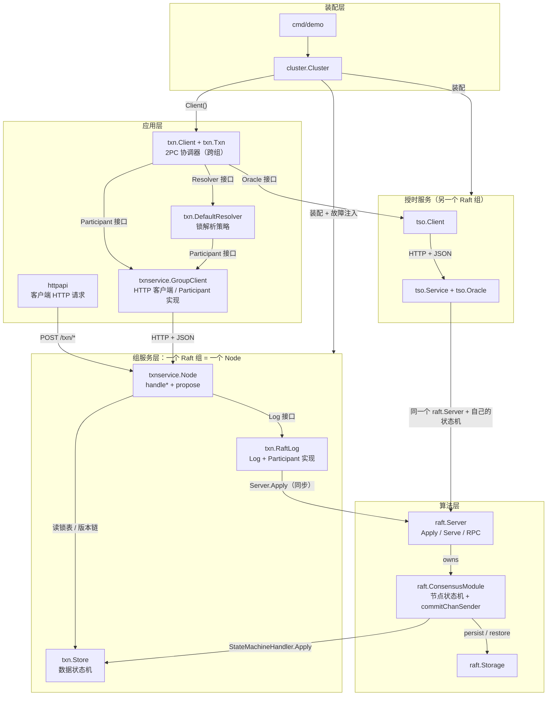
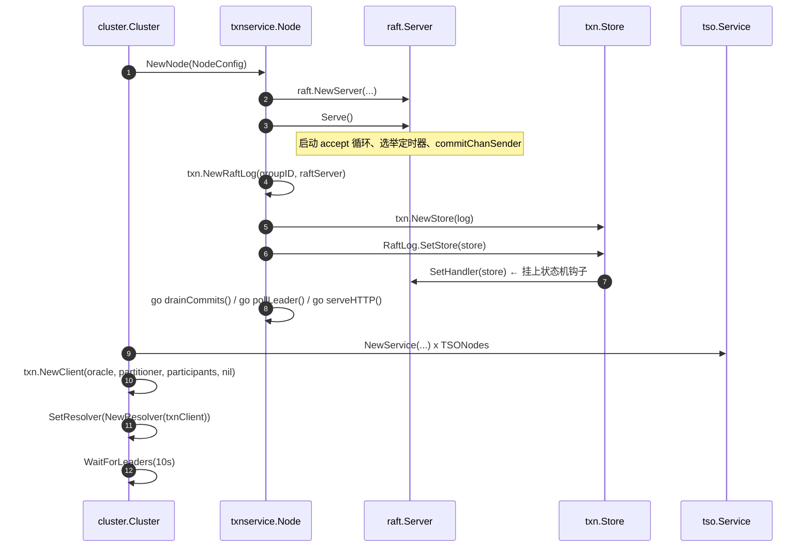
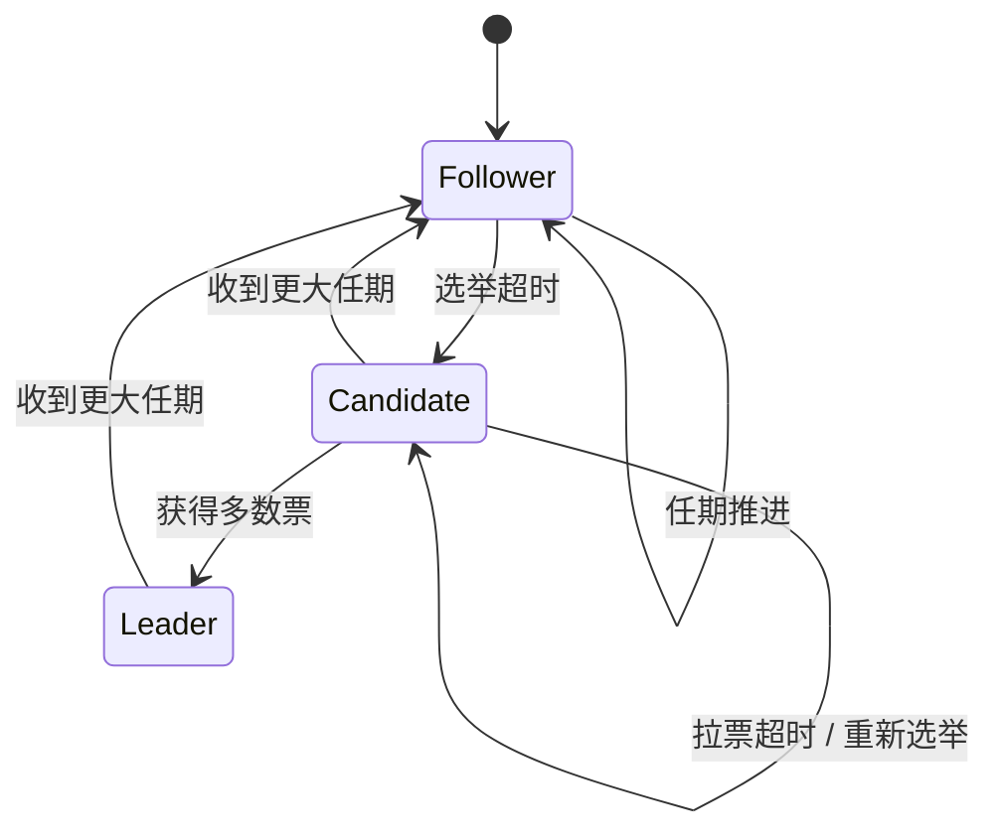
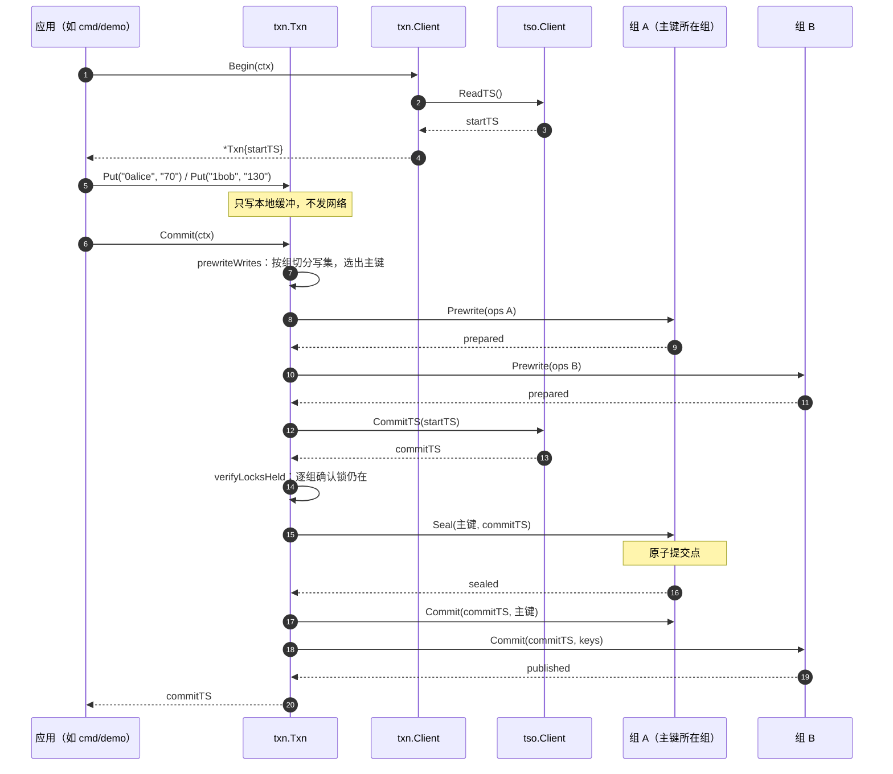
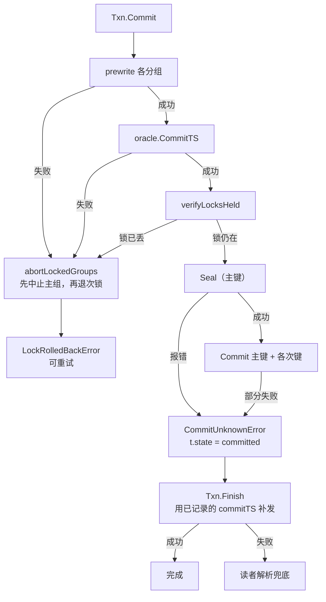

# 05 — 工作流程分析：按模块关联关系

> English version: [05-workflow-analysis.md](05-workflow-analysis.md)

本文是一篇**按模块关联关系**展开的代码库工作流程分析。它不重复讲设计动机 ——
那是 [`docs/02-transaction-design.md`](02-transaction-design.md) 的职责；本文只回答三个问题：

1. 代码被拆成了哪些**模块**，每个模块的职责边界在哪里；
2. 模块之间**通过什么关联**（调用、channel、接口实现、HTTP）；
3. 一条请求走完整个系统时，**这些关联按什么顺序被用到**。

分析方法参照一篇对 etcd 中 raft 实现做源码走读的文章（下文称「参照文章」）：它先给出术语表
与宏观架构，再逐层拆解核心数据结构，然后重点分析**层间交互流程**，最后把写流程、读流程各自
拆成若干带编号的步骤，每一步都点明「哪个模块 → 调用什么 → 什么数据结构跨过了边界」。本文
沿用这套骨架，并在每个关键处指出**本仓库与 etcd 的结构性差异** —— 那些差异正是这套代码的
设计要点所在。

---

## 0 前言

参照文章分析了 etcd v3.1.10 的 raft 实现：etcd 把 raft 拆成**算法层**（`./raft/*`，
可独立引入的 SDK）与**应用层**（`contrib/raftexample/*`），两层各自跑在独立 goroutine 中，
靠几个 channel 做异步通信，并以 `Ready`/`Advance` 作为一轮交互的边界。

本仓库面对同样的结构问题，但给出的答案不同。**这个不同点是理解本代码库的钥匙**：

| 关注点 | etcd（参照文章） | 本仓库 |
|---|---|---|
| 算法层与事务层的边界 | etcd 的 raft 是通用共识库 | `internal/raft` 同样是通用共识库，但**新增了一个状态机钩子**（`StateMachineHandler`） |
| 应用层与算法层的通信 | 几个 channel（`propc`/`recvc`/`readyc`/`advancec`）+ `Ready`/`Advance` 协议，**异步** | `Server.Apply`：提议 + 等待，**同步**。`Ready`/`Advance` 那一层协议在本地扩展中被移除了 |
| 谁驱动定时 | 应用层定时调用 `Node.Tick()` | `ConsensusModule` 内部的选举定时器自己计时，无外部 Tick |
| 谁应用状态机 | 应用层从 `commitChan` 读到已提交条目后自己应用 | **`commitChanSender` 在提交路径上直接应用**，应用层只负责把 channel 排空 |
| 跨组事务 | etcd 单组（v3.1 时代）；事务在别处 | `txn` 层做 Multi-Raft 的 2PC 协调，`txnservice` 只服务**一个组** |

下面逐节展开。

---

## 1 模块划分

与 raft 相关的代码分布如下。**「层」这一列是本文后续所有讨论的坐标**。

| 模块 | 目录 | 层 | 职责 |
|---|---|---|---|
| 共识算法层 | `internal/raft/*` | 算法层 | Raft 本体：选举、日志复制、持久化、RPC 传输。上游 `part3/raft` 加少量标记为「本地扩展」的新增项 |
| 组服务层 | `txnservice/*` | 应用层 | 把**一个** Raft 组装配成可被远程访问的服务：算法层 + 事务状态机 + HTTP 接口 |
| 事务协议层 | `txn/*` | 应用层（协议） | MVCC 状态机、意向锁、2PC 协调器、锁解析策略。**定义全部接口** |
| 授时服务 | `tso/*` | 应用层（独立共识组） | 基于 Raft 复制的 timestamp oracle，同样跑在算法层之上 |
| 集群装配 | `cluster/*` | 装配层 | 把多个组、多个 oracle 成员装成一个 Multi-Raft 集群，并提供故障注入 |
| 演示程序 | `cmd/demo/*` | 装配层 | 可运行的端到端演示 |

**关键的结构事实：`txn` 定义接口，其他模块实现接口。** 这使同一份协调逻辑既能跑在 HTTP 之上
（生产路径），也能跑在进程内（测试与 `cluster`）。§3 会具体展开这一点。

---

## 2 术语表

参照文章先固定术语的做法很值得沿用：本代码库里「层」「状态机」「提交」都有两个含义，不先
说清楚后面必然歧义。

| 中文名 | 英文名 / 代码标识 | 说明 |
|---|---|---|
| 算法层 | algorithm layer / `internal/raft` | 内聚 Raft 共识机制的模块。被上层以库的形式引入，**不感知事务、键值或 HTTP** |
| 应用层 | application layer | 聚合存储、通信与 HTTP 能力的模块。承上启下：对外服务客户端，对内使用算法层 |
| 组服务 | group service / `txnservice.Node` | 应用层中「一个 Raft 组」的抽象。持有算法层 `*raft.Server`、事务状态机 `*txn.Store`，并暴露 HTTP |
| 事务协调器 | coordinator / `txn.Client` | 跨组 2PC 的发起者。本身**不是** Raft 节点，是一段客户端逻辑 |
| 事务句柄 | transaction handle / `txn.Txn` | 一笔事务的全部本地状态（快照时间戳、写集、已准备组）。`Client` 无事务状态，故可并发复用 |
| 数据状态机 | data state machine / `txn.Store` | 真正存数据的介质：版本链 + 锁表 + 事务记录。为避免与「Raft 节点状态机」混淆，本文一律称**数据状态机** |
| 节点状态机 | node state machine / `ConsensusModule` | Raft 节点本身是个状态机：任何输入（选举超时、收到 RPC、被提议命令）都驱动其状态变化 |
| 提议 | proposal / `ConsensusModule.propose` | 两阶段提交的第一阶段：把命令追加进日志 |
| 提交 | commit / `commitIndex` 推进 | 第二阶段：日志被多数派复制，可以对外生效 |
| 应用 | apply / `StateMachineHandler.Apply` | 把已提交日志喂给数据状态机，使写请求真正生效 |
| 屏障 | barrier / `CmdBarrier` | 一条**空操作**日志条目，唯一意义是它在日志中的位置：等它被应用，即证明它之前的条目都已应用 |
| 封印 | seal / `CmdSeal` | 把提交时间戳写进**主键**的锁记录，但**不**发布版本。**封印主键即事务的原子提交点** |
| 主键 / 次键 | primary / secondary key | 一张分布式锁表。主键承载事务的提交决定；次键只能去问主键 |
| 租约 | lease / `LockRecord.ExpiresAt` | 锁的存活期限，界定读者等待多久；**它不授权回滚**（见 §7.5） |
| 解析 | resolution / `Client.resolveLock` | 读者撞上一把他人遗留的锁时，判定该事务的结局并据此发布或丢弃 |
| 授时服务 | timestamp oracle / `tso` | 全局单调唯一的时间戳来源，本身是一个 Raft 组 |
| 快照时间戳 | start timestamp / `Txn.startTS` | 事务读取所用的一致性视点 |
| 提交时间戳 | commit timestamp / `Txn.committedTS` | 事务写入对外可见的时间点 |

---

## 3 宏观架构

### 3.1 算法层

算法层是 Raft 共识机制的核心实现：任期与投票、日志复制、持久化、RPC 传输。它的**全部输入**
只有三类：收到的 peer RPC、被本地提议的命令、选举定时器到期。

本仓库对算法层做的最重要扩展是引入了一个**状态机钩子**：

```
StateMachineHandler.Apply(command any) any
```

上游 `part3/raft` 没有这个概念 —— 上游把已提交条目交给应用层，由应用层自己决定怎么应用。
本仓库让**组本身成为状态机**：`Server.Apply` 提议一条命令后，等 `commitChanSender` 把这条
条目应用完，再把数据状态机的回答原路返回给提议者。

这带来两个后果，是理解后面所有流程的前提：

1. **提议可以是同步的。** 协调器调用 `Participant.Prewrite` 拿到的不是一个日志索引，而是
   数据状态机对这次 prewrite 的判定结果（成功 / 冲突 / 锁被占）。没有第二套「用日志索引去
   关联结果」的机制。
2. **应用必须发生在共识锁之外。** `commitChanSender` 在调用 `handler.Apply` 前先释放
   `cm.mu`；否则数据状态机自己的锁会和共识锁形成环，并让一次慢应用拖住选举与心跳。

### 3.2 组服务层

`txnservice.Node` 是算法层之上的装配体，它把一个 Raft 组变成可远程访问的服务：

```
        HTTP 客户端（txnservice.GroupClient）
                    │  POST /txn/prewrite/ 等
                    ▼
        ┌───────────────────────────────────────────┐
        │  Node（一个 Raft 组）                      │
        │   httpServer  ──> handlePrewrite ...       │  应用层：协议与传输
        │        │ propose(cmd, render)              │
        │        ▼                                   │
        │   RaftLog.ApplyCommand ──> Server.Apply    │  ← 层间边界
        │        │                                   │
        │   raft.Server / ConsensusModule            │  算法层：共识
        │        │ commitChanSender: handler.Apply   │  ← 状态机钩子
        │        ▼                                   │
        │   txn.Store（数据状态机）                   │  应用层：MVCC + 锁
        └───────────────────────────────────────────┘
```

注意 `Node` 里那个 `commitChan`：算法层仍会把已提交条目发到它上面，但**它不再驱动状态机**
（状态机已经在同步路径上应用过了）。`Node.drainCommits` 这个 goroutine 的存在只是为了把
channel 排空，否则算法层的提交发送方会被阻塞。这是「用同步 `Apply` 取代 `Ready`/`Advance`」
之后必然出现的结构性残留，也是与 etcd 最直观的一处对照。

### 3.3 宏观架构：模块之间靠什么关联

这是全文最重要的一张图。它标出每个模块，以及**模块之间那条边上到底是什么**：



**读法**：实线边上的标签就是那条关联的**类型**。可以看到三条清晰的规律：

1. **`txn` 只定义接口，不实现传输。** `Participant`、`Log`、`Oracle`、`Resolver`、`Partitioner`
   全部定义在 `txn` 包里；`txnservice`、`tso`、`internal/raft` 各自实现其中一个。
2. **算法层只通过两个口与外界相连**：入方向是 `Server.Apply`，出方向是 `StateMachineHandler.Apply`。
   算法层不知道事务、键或 HTTP 的存在。
3. **跨组的一切都发生在协调器里，而不是在任何一个 Raft 组里。** 每个 Raft 组只服务自己那片
   键空间；2PC 的编排完全在 `txn.Client` 这一段客户端逻辑中。

---

## 4 算法层核心数据结构

本节按参照文章的方式逐个介绍。读者在后续流程章节遇到不明确的结构可回查此处。

### 4.1 LogEntry / CommitEntry

```go
// internal/raft/raft.go -- simplified
type LogEntry struct {
    Command any
    Term    int
}

type CommitEntry struct {
    Command any
    Index   int
    Term    int
}
```

一条 `LogEntry` 就是一笔预写日志。注意 `Command` 是 `any`：算法层**不关心**里面装的是事务
命令还是别的什么，这正是它能被复用（并被 `tso` 复用）的原因。`CommitEntry` 是同一笔日志在
「已提交」之后的形态，多了 `Index`，因为它要送去给上层定位。

本仓库的日志索引从 0 开始，且 `LogEntry` 没有独立的 `Index` 字段 —— 索引就是它在切片中的
位置。上游如此，本仓库未改。

### 4.2 Server

```go
// internal/raft/server.go -- simplified
type Server struct {
    serverId    int
    peerIds     []int
    cm          *ConsensusModule   // 算法核心
    storage     Storage
    ready       <-chan any
    commitChan  chan<- CommitEntry
    rpcServer   *rpc.Server
    rpcProxy    *RPCProxy
    listener    net.Listener
    peerClients map[int]*rpc.Client
    conns       map[net.Conn]struct{}   // 本地扩展：Shutdown 用
    quit        chan any
    acceptDone  chan struct{}           // 本地扩展：等 accept 循环退出
    wg          sync.WaitGroup
    mu          sync.Mutex
}
```

`Server` 是**传输 + 生命周期**的封装，共识算法本身全在 `ConsensusModule` 里。`Server` 承担的
三件事：监听 TCP 并用 `net/rpc` 提供 peer 间通信；管理到各 peer 的出向 `*rpc.Client`；把
`Apply`/`Shutdown` 这类「本地调用」翻译成对 `ConsensusModule` 的操作。

`conns` 与 `acceptDone` 是本仓库新增的：上游的 `Shutdown` 会等待可能永久阻塞在读对端数据的
处理函数，多个节点同时停止时极易挂死。

### 4.3 ConsensusModule（节点状态机）

```go
// internal/raft/raft.go -- simplified
type ConsensusModule struct {
    id        int
    peerIds   []int
    state     CMState          // Follower | Candidate | Leader | Dead
    currentTerm int
    votedFor    int

    log         []LogEntry
    commitIndex int
    lastApplied int

    // 本地扩展：状态机钩子
    handler StateMachineHandler

    // 本地扩展：同步提议的关联表
    results map[int]chan proposalResult

    // 本地扩展：唤醒与停机
    newCommitReadyChan   chan struct{}
    newCommitReadyChanWg sync.WaitGroup
    stopChan             chan struct{}
    electionTimerWg      sync.WaitGroup

    leaderId int   // 本地扩展：给客户端指路
    // ... 选举定时器、peer 进度等
}
```

参照文章说 etcd 的 raft 节点本质是个大状态机，任何操作最后都封装成一则消息输入状态机。
**本仓库不是这个形状**：这里没有统一的 `Step(Message)` 入口，也没有按角色分派的
`stepLeader`/`stepCandidate`/`stepFollower`。取而代之的是三条互不相同的入口：

| 入口 | 触发者 | 效果 |
|---|---|---|
| `Server.Apply(cmd)` | 本地提议（HTTP 请求） | `propose` 追加日志 → 唤醒复制；登记结果 channel；等结果 |
| `RPCProxy.RequestVote/AppendEntries` | 远端 peer | 进入 `ConsensusModule` 的对应方法 |
| `runElectionTimer` | 内部定时器 | 超时则发起选举 |

这是与 etcd 最本质的结构差异，也是本仓库代码量小的原因：**它不需要用一个通用 `Message`
结构去覆盖所有场景**。（参照文章也批评了 etcd 那个大而全的 `Message` 破坏了职责单一原则；
本仓库相当于用三个专用入口规避了这一点，代价是没有 etcd 那样的可扩展性。）

`results` 是同步提议的关键：`map[日志索引]结果channel`。提议者登记自己的 channel，应用者
在应用完那条条目后投递结果。

### 4.4 StateMachineHandler（层间唯一的出向接口）

```go
// internal/raft/raft.go -- simplified
type StateMachineHandler interface {
    Apply(command any) any
}
```

只有一个方法的接口，却是整个架构的枢纽：它是算法层**唯一**的数据出口。`txn.Store` 实现它，
于是「共识层」与「事务层」在类型层面完成解耦 —— 算法层不知道 `TxnCommand` 是什么。

### 4.5 proposalResult

```go
type proposalResult struct {
    value any
    err   error
}
```

同步提议的返回值载体。`value` 就是 `handler.Apply` 返回的东西 —— 对本仓库而言，是
`txn.TxnResult`。

### 4.6 Storage

```go
// internal/raft/storage.go -- simplified
type Storage interface {
    Set(key string, value []byte)
    Get(key string) ([]byte, bool)
    HasData() bool
}
```

持久化接口，`MapStorage` 是内存实现。注意值是 `[]byte` 而不是 `any`：状态机层面虽然允许
任意 Go 值，但**持久化层面只认字节**，因为算法层要自己决定序列化格式 ——
`persistToStorage` 用 `gob` 把 `currentTerm`、`votedFor` 和**整个日志**分别编码后写入三个键。

上游的实现每次变更都把整个日志重新 gob 编码后写入，是日志长度的平方级开销 —— 这是已知
且被有意保留的简化。

---

## 5 组服务层与事务协议层核心数据结构

### 5.1 txnservice.Node（组服务）

```go
// txnservice/service.go -- simplified
type Node struct {
    cfg     NodeConfig
    groupID txn.GroupID

    raftServer *raft.Server    // 算法层入口
    log        *txn.RaftLog    // Log 接口 + Participant 接口实现
    store      *txn.Store      // 数据状态机

    commitChan chan raft.CommitEntry  // 只用于排空，不驱动状态机
    httpServer *http.Server
    listener   net.Listener
    leaders    atomic.Int64            // 路由提示
    quit       chan struct{}
    wg         sync.WaitGroup
}
```

`Node` 是「一个 Raft 组」在应用层的抽象，同时扮演**服务端**（对外提供 HTTP）和**算法层使用者**
（对内调用 `ApplyCommand`）。它的构造顺序值得记住，因为它就是一条依赖链：

```
raft.NewServer(...) → Serve()          算法层起来
txn.NewRaftLog(groupID, raftServer)    适配成 Log 接口
txn.NewStore(log)                      数据状态机
raftServer.SetHandler(store)           挂上状态机钩子
```

### 5.2 txn.RaftLog（层间适配器）

```go
// txn/raftadapter.go -- simplified
type RaftLog struct {
    server  *raft.Server
    groupID GroupID
    mu      sync.RWMutex
    store   *Store        // 延迟绑定
    learnedLeader int
}
```

`RaftLog` 是**唯一同时实现 `Log` 与 `Participant` 的类**：

- 实现 `Log`：`ApplyCommand` → `server.Apply(cmd)`；这是数据状态机复制命令的通道。
- 实现 `Participant`：`Read`/`Prewrite`/`Seal`/`Commit`/`Rollback`/`Locked`/`Barrier`，
  每个方法把参数包成 `TxnCommand` 再走同一个 `ApplyCommand`。

也就是说，**`Participant` 的七个方法在进程内路径上都是 `ApplyCommand` 的一层薄包装**，
差别只在参数结构与结果解释。这一点在 §6 的对照表里会非常直观。

### 5.3 txn.Store（数据状态机）

```go
// txn/store.go -- simplified
type Store struct {
    log       Log
    lockTTL   time.Duration
    nowMillis func() uint64

    versions map[Key][]Version    // MVCC 版本链
    locks    map[Key]*LockRecord  // 意向锁表
    actors   map[TxnID]*Actor     // 事务记录

    appliedCommitTS Timestamp     // 水位：已应用的最高提交时间戳
}
```

三个 map 就是全部数据，`Apply(command any) any` 是唯一入口。**整个数据状态机没有一把自己的
互斥锁** —— 因为 Raft 已经保证了同一时刻只有一个 goroutine 在应用条目。这是「让组成为状态机」
带来的直接好处。

三个 map 各自回答一个不同的问题：

- `versions` 回答「快照 S 能看到什么」；
- `locks` 回答「有没有一笔写入正在被扣住」；
- `actors` 回答「这笔事务决定了没有」—— 这是次级锁的读者唯一能问的地方。

### 5.4 txn.Client 与 txn.Txn（协调器与事务句柄）

```go
// txn/client.go -- simplified
type Client struct {
    oracle       Oracle
    partitioner  Partitioner
    participants map[GroupID]Participant
    resolver     Resolver
    resolveTimeout time.Duration
    now          func() uint64
    clientID     int64
    requests     atomic.Int64
    // ... 统计
}

type Txn struct {
    c       *Client
    id      TxnID
    startTS Timestamp
    writes  map[Key]WriteOp
    prepared map[GroupID]struct{}
    primaryKey Key
    committedTS Timestamp
    state   state
    barriered map[GroupID]struct{}
}
```

这个划分是刻意的：**`Client` 不持有任何事务状态**，所以一个 `Client` 可以并发服务许多事务；
**`Txn` 持有全部事务状态**，因此明确「不安全并发使用」。`barriered` 记录已经取过读屏障的组，
保证每组每事务只取一次。

### 5.5 txn.TxnCommand（跨组协议的命令词汇）

```go
// txn/command.go -- simplified
type TxnCommand struct {
    Kind TxnCommandKind
    ReadArgs        *ReadArgs
    PrewriteArgs    *PrewriteRequest
    SealArgs        *SealArgs
    CommitArgs      *CommitRequest
    RollbackArgs    *RollbackRequest
    ResolveLockArgs *ResolveLockArgs
    QueryLockArgs   *QueryLockArgs
}
```

七种命令，全部走同一条 `Raft` 日志。`CmdBarrier` 是第八种：不携带任何负载，唯一意义是它的
**位置**。

---

## 6 层间交互流程

### 6.1 两种 Participant 实现 —— 同一个协调器的两条路

这是本仓库最值得单独讲的一处结构设计。参照文章里，应用层与算法层靠 channel 异步通信，
只有一条路径；本仓库有**两条**，而且协调器代码对二者完全无感：

| `Participant` 方法 | HTTP 路径（`txnservice.GroupClient`） | 进程内路径（`txn.RaftLog`） |
|---|---|---|
| `Read` | `POST /txn/read/` → `handleRead` → `propose` | `ApplyCommand(CmdRead)` |
| `Prewrite` | `POST /txn/prewrite/` → `handlePrewrite` | `ApplyCommand(CmdPrewrite)` |
| `Seal` | `POST /txn/seal/` → `handleSeal` | `ApplyCommand(CmdSeal)` |
| `Commit` | `POST /txn/commit/` → `handleCommit` | `ApplyCommand(CmdCommit)` |
| `Rollback` | `POST /txn/rollback/` → `handleRollback` | `ApplyCommand(CmdRollback)` |
| `Locked` | `POST /txn/locked/` → `handleLocked` | `ApplyCommand(CmdQueryLock)` |
| `Barrier` | `POST /txn/barrier/` → `handleBarrier` | `ApplyCommand(CmdBarrier)` |

两条路径最终都汇聚到 `Server.Apply`。HTTP 路径多做的事只有两件：JSON 编解码，以及
**跟随 leader 提示**（`GroupClient.callFor` 在收到 `not-leader` 时直接跳到提示的节点重试）。
进程内路径则由 `RaftLog.ApplyCommand` 把 `NotLeaderError` 原样返回给调用方重试。

**为什么值得这样做**：测试与 `cluster` 需要一个多组集群，若每个组都要起 HTTP 端口，成本和
不确定性都会上升。有了这层接口，`cluster` 可以选择任意一条路径装配，而 `txn` 的 2PC 逻辑
一行都不用改。

### 6.2 一轮同步提议：`Server.Apply` 的六个动作

这是算法层与应用层之间**唯一的入向边界**，值得逐步展开：

```go
// internal/raft/server.go —— Apply（已简化，保留结构与注释）
index := cm.propose(cmd)                    // (1) 追加日志，拿到索引
ch := make(chan proposalResult, 1)          // (2) 建结果 channel（缓冲 1）
cm.results[index] = ch                      // (3) 登记关联：索引 → channel
if cm.commitIndex >= index {                // (4) 若已提交，催一次应用者
    select {
    case cm.newCommitReadyChan <- struct{}{}:
    default:
    }
}
cm.mu.Unlock()                              // (5) 放锁，然后等
select {
case res := <-ch:                           // (6a) 应用者投递了结果
case <-cm.stopChan:                         // (6b) 停机
case <-timer.C:                             // (6c) 超时（无多数派）
}
```

对应地在算法层的应用侧：

```go
// internal/raft/raft.go —— commitChanSender（已简化，仅保留循环体）
for range cm.newCommitReadyChan {
    cm.mu.Lock()
    entries = cm.log[cm.lastApplied+1 : cm.commitIndex+1]   // 取新提交的条目
    cm.lastApplied = cm.commitIndex
    handler := cm.handler
    cm.mu.Unlock()                                          // 关键：放锁再应用

    for i, entry := range entries {
        var result any
        if handler != nil {
            result = handler.Apply(entry.Command)           // 应用数据状态机
        }

        cm.mu.Lock()
        if ch, ok := cm.results[index]; ok {                // 找到提议者
            delete(cm.results, index)
            cm.mu.Unlock()
            select {
            case ch <- proposalResult{value: result, err: applyErr}:
            default:
            }
        } else {
            cm.mu.Unlock()
        }
        select {
        case cm.commitChan <- CommitEntry{
            Command: entry.Command,
            Index:   index,
            Term:    savedTerm,
        }:
        case <-cm.stopChan:
            return
        }
    }
}
```

**这段代码解释了本仓库为什么不需要 `Ready`/`Advance`。** etcd 里，算法层把「这一轮的结果」
打包进 `Ready` 交给应用层，应用层做完持久化与发送后调 `Advance` 表示收工，两者靠这一对方法
界定一轮交互。本仓库把这一轮**折叠进了一次函数调用**：`propose` 登记、应用者投递、
`Apply` 取结果，调用返回即一轮结束。副作用是 `commitChan` 退化成「只为了不让发送方阻塞」
的排空通道（`Node.drainCommits`）。

**两个必须写对的细节**，注释里也点明了：

- 结果 channel 必须在**释放 `cm.mu` 之前**登记，否则应用者可能在无人监听时投递。
- 投递用非阻塞 `select`：应用者不能因为某个提议者已经放弃等待而卡住整个日志推进。

### 6.3 启动顺序（依赖链）



`cluster.New` 里那两行顺序是有含义的：协调器与解析器**互相引用**（解析器要走协调器的
participant 集合，协调器需要解析器来清理外来的锁），所以先建协调器，再建解析器，然后回填。

---

## 7 角色状态机与两条核心链路

### 7.1 Raft 角色转换（算法层内部）

本仓库的角色转换不用 `Step(Message)` 分派，而是由三处直接调用：



与事务层相关的一点：**领导权变化不影响正确性，只影响可用性与延迟**。协调器拿到
`NotLeaderError` 就换节点重试；`txnservice.GroupClient` 会记住提示的 leader 以免重复试探。

### 7.2 写流程：跨组事务提交（八个步骤）

这是整个代码库最核心的一条链路。它跨越**两个 Raft 组 + 授时服务 + 协调器**，因此比 etcd
的单组写流程更能体现模块关联关系。



逐步对应模块与数据结构：

| 步 | 模块 | 调用 | 跨边界的数据 |
|---|---|---|---|
| 1 | 应用 → `txn.Client` | `Begin(ctx)` | — |
| 2 | `Client` → `tso.Client` | `ReadTS(ctx)` | HTTP + JSON（`NextRequest`/`NextResponse`） |
| 3 | 应用 → `Txn` | `Put` / `Delete` | 只进 `Txn.writes`，**无任何网络** |
| 4 | `Txn` → 各组 | `prewriteWrites` 后逐组 `Participant.Prewrite` | `PrewriteRequest`（含 `Ops`、`Primary`、`StartTS`） |
| 5 | `Txn` → `tso.Client` | `CommitTS(startTS)` | HTTP + JSON |
| 6 | `Txn` → 各组 | `verifyLocksHeld` → `Participant.Locked` | `CmdQueryLock` |
| 7 | `Txn` → 主键组 | `Participant.Seal` | `SealArgs`；**写进主锁即提交点** |
| 8 | `Txn` → 各组 | `Participant.Commit` | `CommitRequest`；由此 `Store.commit` → `publishVersion` |

**第 4 步的组内展开**（以组 A 为例），这是算法层真正被用到的地方：

```
GroupClient.Prewrite        应用层：HTTP 客户端
  → Node.handlePrewrite     应用层：HTTP 服务端，解码 JSON
  → Node.propose            应用层：先做 leader 自查（省一次日志往返）
  → RaftLog.ApplyCommand    适配层：包成 TxnCommand
  → Server.Apply            算法层：propose + 等结果
      → ConsensusModule.propose        追加日志 → 触发复制
      → commitChanSender               日志被多数派复制后
          → Store.Apply(TxnCommand)    数据状态机：写锁、查冲突
      → cm.results[index] <- result    回传
  → 渲染 WriteResponse → HTTP 响应
```

**第 7 步为什么是提交点**：`Seal` 只把 `commitTS` 写进主锁的记录里，**不发布任何版本**。
一旦这条日志被应用，任何撞上该事务任一把锁的读者都能从主键问出结局，从而自己把写入补完 ——
这就是「协调器死了也能推进」的机制来源。

### 7.3 读流程（六个步骤）

读流程比写流程短，但包含本仓库特有的**读屏障**环节：

| 步 | 模块 | 调用 | 说明 |
|---|---|---|---|
| 1 | `Client` → `tso.Client` | `ReadTS` | 取快照时间戳 S |
| 2 | `Txn` → 目标组 | `Participant.Barrier` | 每组一次：等一条空操作日志被应用 |
| 3 | 屏障之后 | `Store.AppliedCommitTS` | 水位可用于校验；**屏障本身不依赖它** |
| 4 | `Txn` → 目标组 | `Participant.Read(startTS, key)` | 按严格可见性 `CommitTS < S` 取版本 |
| 5 | 若撞锁 | `Client.resolveLock` → `Resolver` | 判定属主结局：已提交则发布，否则**请求主组记录中止** |
| 6 | 重试第 4 步 | | 锁清掉后读到干净结果 |

**第 2 步的必要性**：只读事务对每个键各发一次 Raft 往返，各自带同一个时间戳 S。**Raft 只保证
每个组内部有序，不保证跨组的两次读落在同一瞬间**。屏障利用「日志按序应用」这一性质：等一条
空操作条目被应用，即证明该组已应用它之前的全部条目；而任何提交时间戳小于 S 的事务，其写入
必然在屏障之前就已进入该组日志。证明见 [`docs/03-read-barrier.md`](03-read-barrier.md) §1.2。

**第 5 步的安全边界**：读者**不得**因为锁的租约过期就丢弃它。租约只说明属主不再刷新锁，
不说明属主不能再封印。因此读者必须向主组请求一次 **compare-and-abort**：主组复查自己的状态，
若事务已提交则返回「已提交」，读者改为**发布**；否则记录中止。这条规则是
[`docs/03-read-barrier.md`](03-read-barrier.md) §2 那场丢写入竞态的修复核心。

---

## 8 模块关联关系总表

把全文的关联收成一张表。**这张表是本文的结论**：

| 从 | 到 | 关联类型 | 定义处 | 实现处 |
|---|---|---|---|---|
| 应用 | `txnservice.Node` | HTTP + JSON | `txnservice/api.go` | `Node.handle*` |
| `txn.Client` | 各组 | `Participant` 接口 | `txn/types.go` | `txnservice.GroupClient`（HTTP）/ `txn.RaftLog`（进程内） |
| `txn.Client` | 授时 | `Oracle` 接口 | `txn/types.go` | `tso.Client` |
| `txn.Client` | 锁清理 | `Resolver` 接口 | `txn/types.go` | `txn.DefaultResolver` |
| `txn.Client` | 路由 | `Partitioner` 接口 | `txn/types.go` | `HashPartitioner` / `StaticPartitioner` |
| `txn.Store` | 复制 | `Log` 接口 | `txn/store.go` | `txn.RaftLog` |
| `txn.RaftLog` | 共识 | `Server.Apply` | `internal/raft/server.go` | — |
| `raft.ConsensusModule` | 数据状态机 | `StateMachineHandler` 接口 | `internal/raft/raft.go` | `txn.Store` |
| `tso.Service` | 共识 | 同一个 `raft.Server` | — | `tso.Oracle` 作为其 handler |
| `cluster.Cluster` | 全部 | 装配 + 故障注入 | `cluster/cluster.go` | — |

三条贯穿全文的规律：

1. **接口集中在 `txn`，实现分散在外围。** 因此替换传输层（HTTP ↔ 进程内）不需要改动一行
   协调器代码 —— 这正是 `cluster` 能在两种装配之间自由选择的原因。
2. **算法层与外界的接触面只有两个**：入向 `Server.Apply`，出向 `StateMachineHandler.Apply`。
   算法层对其承载的是事务毫不知情，这也是 `tso` 能复用同一个 `raft.Server` 的原因。
3. **跨组编排全部在协调器（客户端侧）完成。** 每个 Raft 组只服务自己那片键空间，组与组之间
   **不存在**直接通信。这是 Multi-Raft 与「一个 Raft 组管所有数据」的根本区别，也是 2PC、
   主键、读屏障这一整套机制存在的原因。

---

## 9 关键代码解析（一）：请求进入共识层之前的六道关

§3.2 提到 `handle*` 并不直接调用 `Store`。这一节把那句话展开：一条 HTTP 请求要真正进入
Raft 日志，必须依次通过六道关，**每道关都有明确的拒绝理由**。

```go
// txnservice/service.go
func (n *Node) propose(w http.ResponseWriter, req *http.Request, cmd txn.TxnCommand,
	render func(txn.TxnResult) any) {
	if !n.IsLeader() {
		// Avoid one wasted log round trip per request by answering with a routing
		// hint, so the client goes straight to the leader. This is an
		// optimization, not a consistency requirement: Apply would reject the
		// command anyway.
		writeJSON(w, notLeaderPayload(n.LeaderHint(), int(n.groupID)))
		return
	}

	res, err := n.log.ApplyCommand(req.Context(), cmd)
	if err != nil {
		var notLeader *txn.NotLeaderError
		if errors.As(err, &notLeader) {
			writeJSON(w, notLeaderPayload(notLeader.LeaderID, int(notLeader.GroupID)))
			return
		}
		writeJSON(w, internalErrorPayload(err))
		return
	}
	writeJSON(w, render(res))
}
```

这二十来行里有三个容易忽略的要点：

1. **`IsLeader()` 自查是纯优化。** 注释说得很直白：即使不查，`Server.Apply` 也会拒绝非
   leader 的命令（它自己会持锁复查状态）。这一查只是省掉一次注定失败的日志往返。**这一点
   很重要**：它意味着这条快速路径的正确性不依赖于 `IsLeader()` 的实现质量 —— 它可能给出
   过期的 `true`，而那种情况下 `ApplyCommand` 会返回 `NotLeaderError`，走下面的分支。
2. **两条 `not-leader` 分支的语义不同。** 上面那条由 `Node` 自己产生（连日志都没进），下面
   那条来自 `RaftLog.ApplyCommand` 对 `raft.NotLeaderError` 的翻译。两条都返回 leader 提示，
   所以客户端无需区分。
3. **`render` 是延迟执行的。** 命令先被复制并应用，拿到 `TxnResult` 之后才由 `render` 转成
   具体的响应结构（`WriteResponse` 或 `LockedResponse`）。失败路径根本不构造响应体。

接下来是第六道关 —— `RaftLog.ApplyCommand` 对 `*raft.Server` 的适配：

```go
// txn/raftadapter.go
func (rl *RaftLog) ApplyCommand(ctx context.Context, cmd TxnCommand) (TxnResult, error) {
	if ctx != nil {
		select {
		case <-ctx.Done():
			return TxnResult{}, ctx.Err()
		default:
		}
	}

	out, err := rl.server.Apply(cmd)
	if err != nil {
		var notLeader *raft.NotLeaderError
		if errors.As(err, &notLeader) {
			rl.learnLeader(notLeader.LeaderID)
			return TxnResult{}, &NotLeaderError{GroupID: rl.groupID, LeaderID: notLeader.LeaderID}
		}
		return TxnResult{}, err
	}

	// A leader that lost leadership between the check and the apply returns nil:
	// the command was not applied. Report it as a routing failure so the caller
	// retries against the new leader.
	if out == nil {
		return TxnResult{}, &NotLeaderError{GroupID: rl.groupID, LeaderID: rl.LeaderHint()}
	}

	res, ok := out.(TxnResult)
	if !ok {
		return TxnResult{}, fmt.Errorf("txn: group %d: state machine returned %T, want TxnResult",
			rl.groupID, out)
	}
	return res, nil
}
```

这是**层间适配的完整内容**：一个类型断言、一次错误翻译、一个边界情形处理。三点值得注意：

- **`out == nil` 不是错误，而是「领导权刚丢」。** 上游的 `Apply` 在某些路径上会静默返回 nil
  表示命令未被应用。适配器不把它当成空结果，而是翻译成 `NotLeaderError` 让上层重试 —— 若
  当作成功，协调器就会基于一个**从未发生的写入**继续推进。
- **`learnLeader` 是提示的本地缓存。** 拿到 `NotLeaderError` 时顺手记下提示的 leader id，
  下一次 `LeaderHint()` 就能立即给出答案，无需再问 Raft。
- **类型断言失败被显式报错。** 如果状态机返回的不是 `TxnResult`，说明有别的模块挂上了
  `StateMachineHandler` —— 这是配置错误，必须响亮地失败。

---

## 10 关键代码解析（二）：事务状态机的三张表

`Store` 的全部数据就是三个 map（§5.3）。它们的**写入时机**完全不同，这正是事务机制的关键：

| 表 | 何时写 | 何时删 | 回答的问题 |
|---|---|---|---|
| `versions map[Key][]Version` | `publishVersion`，即**提交**时 | 永不（无垃圾回收） | 快照 S 能看到什么 |
| `locks map[Key]*LockRecord` | `prewrite`，即**准备**时 | `commit` / `rollback` | 有没有一笔写入正被扣住 |
| `actors map[TxnID]*Actor` | `actorOrCreate`，准备时创建 | 永不 | 这笔事务决定了没有 |

### 10.1 prewrite：先把两把锁的判定做完，再动状态

```go
// txn/store.go
	expiresAt := s.expiresAt()

	// Validate every write before mutating anything, so the group is never left
	// partially locked by a rejected request. (This mirrors the atomicity
	// assumption internal/raft makes about its own storage: one log entry, one
	// state transition.)
	for _, op := range req.Ops {
		if res, bad := s.checkPrewriteOp(req, op, expiresAt); bad {
			return s.memoize(req.TxnID, req.ClientID, req.RequestID, res)
		}
	}

	// Commit point: install the intent locks.
	for _, op := range req.Ops {
		s.locks[op.Key] = &LockRecord{
			TxnID:     req.TxnID,
			StartTS:   req.StartTS,
			Primary:   req.Primary,
			Kind:      op.Kind,
			Value:     op.Value,
			CommitTS:  0,
			ExpiresAt: expiresAt,
		}
	}
```

**两步分离是有意的**：先对整批写操作做完全部校验，再统一落锁。注释把它与 `internal/raft`
的存储原子性假设对应起来 —— 「一条日志条目，一次状态转换」。如果边校验边落锁，一次被拒绝的
请求就会让该组留下**部分锁定**的状态，而这个状态会被复制到所有副本。

`CommitTS: 0` 是关键：它表示「锁已就位，但事务尚未决定」。**封印**（`seal`）才会写入非零值。

### 10.2 两条判定规则必须严格互补

`checkPrewriteOp` 里有两个判定，它们的关系是整个隔离模型的核心：

```go
// txn/store.go —— latestVersionAt（已简化） // simplified
func (s *Store) latestVersionAt(key Key, startTS Timestamp) (Version, bool) {
	versions := s.versions[key]
	best := -1
	for i := range versions {
		if versions[i].CommitTS < startTS {
			best = i
		} else {
			break
		}
	}
	// ...
}
```

```go
// txn/store.go —— writeConflict（已简化）
func (s *Store) writeConflict(key Key, startTS Timestamp) (Timestamp, Timestamp, bool) {
	versions := s.versions[key]
	if len(versions) == 0 {
		return 0, 0, false
	}
	newest := versions[len(versions)-1]
	if newest.CommitTS >= startTS {
		// The newest version is not visible to our snapshot. Report the oldest
		// such version, which is the one we are in conflict with.
		for i := range versions {
			if versions[i].CommitTS >= startTS {
				return versions[i].StartTS, versions[i].CommitTS, true
			}
		}
	}
	return 0, 0, false
}
```

读用严格的 `<`，冲突用 `>=`。**两者必须互为补集**，否则会出现一条宽度为单个时间戳的缝：
某个版本对该快照**不可见**，却不**阻止**写入 —— 于是写入者会覆盖一个它从未看见的提交。

这一点在代码里由一条注释明确锁定，也是
[`docs/02-transaction-design.md`](02-transaction-design.md) §7.4 的主题。值得注意的是，
`writeConflict` 里那段内层循环取的是**最旧的**冲突版本而不是最新的：报给调用方的应该是
「你撞上的那一笔」，这样错误信息才有可诊断性。

### 10.3 seal：只写决定，不发布数据

`seal` 是事务的原子提交点，而它**什么都不发布**：

```go
// txn/store.go —— seal（已简化，保留结构与关键分支）
	lock.CommitTS = args.CommitTS
	s.observeCommitTS(args.CommitTS)
	// Sealing extends the lease: the transaction is now decided, and a reader
	// should get a chance to see the decision before anybody force-resolves it.
	lock.ExpiresAt = s.expiresAt()

	actor := s.actorOrCreate(args.TxnID)
	if actor.Primary == "" {
		actor.Primary = lock.Primary
	}
	// Sealing records the transaction's decision. It is the commit point: the
	// group now knows the transaction is committed even though the write is not
	// published yet. The CmdCommit that follows (issued by the coordinator, or by
	// any reader that discovers this decision) publishes it.
	if !actor.State.Final() {
		actor.State = StateCommitted
	}
	if actor.CommitTS == 0 {
		actor.CommitTS = args.CommitTS
	}
```

三个效果，每个都有明确用途：

1. **`lock.CommitTS` 非零** → 任何读到这把锁的读者都能立刻得知「已提交」，无需再问主组。
2. **`actor.State = StateCommitted`** → 主组自己记住了决定，次级锁的读者来问时能得到答案。
3. **`lock.ExpiresAt` 被延长** → 刚做出决定的事务应该有机会被读出来，而不是立刻被强制解析。

`seal` 之前还挡了一道门 —— **已被中止的事务不能再被封印**（`StatusAlreadyAborted`）。这道
门与「读者只能在中止决定落盘后才丢弃锁」互为印证：两者都靠**同一条 Raft 日志的先后顺序**
来决定谁赢，而不是靠时间戳或租约去猜。

### 10.4 commit：幂等且能分辨「刚做完」与「早就做完了」

```go
// txn/store.go —— commit 的收尾（已简化） // simplified
		s.publishVersion(key, lock.StartTS, commitTS, lock.Kind, lock.Value)
		delete(s.locks, key)
		committed++
		effectiveTS = commitTS
	}
	// ...
	actor = s.actorOrCreate(req.TxnID)
	actor.State = StateCommitted
	if effectiveTS != 0 {
		actor.CommitTS = effectiveTS
	}

	types := StatusOK
	if actor != nil && actor.State == StateCommitted && committed == 0 {
		// Nothing was published and the decision was already on record: this is a
		// retry of a commit that has fully landed. Report it as such so callers
		// can tell "already done" from "just did it".
		types = StatusAlreadyCommitted
	}
```

`publishVersion` 与 `delete(s.locks, key)` 成对出现：**一个版本被发布的同一刻，它的锁消失**。
这两件事在同一条日志条目里完成，因此对所有副本原子。

`StatusAlreadyCommitted` 与 `StatusOK` 的区分不只是好看：`Commit` 请求在网络上可能被重发，
协调器需要知道「我这次真的发布了」还是「别人已经发布过了」—— 前者可以清账，后者说明有人
已经在帮忙收尾。

---

## 11 关键代码解析（三）：事务与共识层的两次握手

§7.2 的八步流程里，第 4 步（prewrite）与第 7 步（seal）是与共识层交互的两个关键点。这一节
把它们各自的一次完整往返摊开。

### 11.1 第一次握手：prewrite

```
协调器                                    某个 Raft 组
────────                                  ────────────
Txn.prewrite
 └ Client.prewriteWrites
    │  primaryKeyOf(writes)               ← 本地算主键，无需协调
    │  byGroup 按分区器切分写集
    └ Participant.Prewrite(req)
       ├─(HTTP 路径) GroupClient.Prewrite
       │   └ callFor → POST /txn/prewrite/
       │                                  Node.handlePrewrite → propose
       │                                   (1) IsLeader 自查
       └─(进程内路径) RaftLog.Prewrite
                                        RaftLog.ApplyCommand
                                         (2) server.Apply(cmd)
                                          ├ cm.propose：追加日志 + 持久化 + 触发复制
                                          ├ cm.results[index] = ch
                                          └ 等 ch
                                        commitChanSender（条目被多数派复制后）
                                         (3) handler.Apply(cmd)
                                          └ Store.Apply → Store.prewrite
                                              ├ checkPrewriteOp × len(Ops)
                                              └ 落锁 + actor.State = StatePrepared
                                         (4) ch <- proposalResult{value: TxnResult}
       ← WriteResponse{status, prepared}  (5) render(res) → JSON
```

**每一步的失败模式都不同，这是这个设计值得注意的地方**：

| 步 | 失败时 | 由谁翻译成什么 |
|---|---|---|
| (1) | 本节点不是 leader | `Node` 直接返回 `not-leader` + 提示，不产生日志 |
| (2) | 复查发现已非 leader | `raft.NotLeaderError` → `txn.NotLeaderError` |
| (2) | 无多数派 | `ApplyTimeout` 后 `abandonProposal`，报「未在时限内提交」 |
| (3) | 写冲突 / 撞锁 | 返回 `TxnResult` **而不是 error**；业务判定走结果，不走错误 |
| (4) | 提议者已放弃 | 非阻塞投递被丢弃，应用者不受影响 |

**第 (3) 步的设计取向值得单独强调**：写冲突和锁冲突都是**正常结果**，通过
`TxnResult.Status` 返回，而不是 Go 的 `error`。这条界线划得很清楚 ——

- `error` 表示**这次 RPC 没能得到一个判定**（路由、超时、停机），调用方应重试；
- `TxnResult.Status` 表示**得到了判定，判定是不行**（冲突、锁被占），调用方应据此改变行为。

如果把两者混在一起，协调器就无法区分「重试可能成功」和「重试一定失败」。§11.3 会看到
这个区分如何被直接用在重试决策上。

### 11.2 第二次握手：seal 与 commit

封印走的是与 prewrite 完全相同的通路，只是命令不同：

```
Txn.commitPrimary(commitTS, prepared)
 ├ participant.Seal(primaryKey, id, startTS, commitTS)
 │   └ TxnCommand{Kind: CmdSeal, SealArgs: &SealArgs{...}}
 │      └ …同 §11.1 的 (2)~(4)…
 │         Store.seal：lock.CommitTS = commitTS
 │                    actor.State  = StateCommitted   ← 事务此刻提交
 │                    lock.ExpiresAt 延长
 └ participant.Commit(CommitRequest{Keys: [primaryKey]})
     └ TxnCommand{Kind: CmdCommit, ...}
        Store.commit：publishVersion + delete(lock)   ← 主键写入可见
```

**封印与提交是两条独立的日志条目，这个拆分是刻意的。** 两者的代价与后果不同：

- `seal` 只需一条日志、$O(1)$ 状态变更。它决定事务的命运。**它失败时事务是否已提交，取决于
  它是否已被多数派接受** —— 这正是 `CommitUnknownError` 存在的原因。
- `commit` 才真正写版本。它需要读取锁记录、按 `CommitTS` 排序追加版本链。**它失败不影响
  事务已提交这一事实**，因为任何读者都能依据封印的锁自行补完。

因此 `commitPrimary` 的失败被翻译成 `CommitUnknownError`（「已提交，但可能没完成」），而不是
普通错误：

```go
	// The atomic commit point.
	if err := t.commitPrimary(ctx, commitTS, prepared); err != nil {
		t.state = stateCommitted
		t.committedTS = commitTS
		return commitTS, &CommitUnknownError{TxnID: t.id, CommitTS: commitTS, Err: err}
	}
```

注意 `t.state = stateCommitted` 是在**返回错误之前**设置的。这看起来反直觉，但它是对的：
封印一旦被提出，事务就不能再回滚了。后续由 `Txn.Finish` 或任意读者把次级写入补完。

### 11.3 失败处理的完整闭环

把上面两次握手串起来，失败处理的闭环是这样的：



三条出口的含义：

| 出口 | 事务的最终状态 | 调用方该做什么 |
|---|---|---|
| 正常成功 | 已提交，全部写入可见 | 继续 |
| `LockRolledBackError` | **未提交**，无任何写入发布 | 重试整笔事务（新事务、新时间戳） |
| `CommitUnknownError` | **已提交**，可能有写入未发布 | 调 `Txn.Finish` 补完，**绝不能重试整笔事务** |

**最后一行是这个设计里最容易写错的地方。** 一笔事务一旦封印，重试它就等于让同一批写入被
应用两次 —— 而它的写集可能是「余额加 1」。`Txn.Finish` 与读者解析的作用正是让「已提交但
未完成」变成一个**可终止**的状态，而不是需要调用方猜测的状态。

`verifyLocksHeld` 的位置同样关键：它在**取提交时间戳之后、封印之前**：

```go
// txn/client.go —— Txn.Commit 中的锁校验（已简化，注释行有省略）
// Every lock must still be in place before the commit point is written.
// ...
// Sealing later cannot repair that, so the check has to happen first. If any
// lock is gone, no commit point has been written and no version published, so
// the transaction is still entirely invisible and aborting is safe.
if err := t.verifyLocksHeld(ctx, prepared); err != nil {
    _ = t.abortLockedGroups(ctx)
    t.state = stateAborted
    return 0, err
}
```

注释里的推理值得逐句读：**检查必须在封印之前，因为事后封印无法挽回一个已被丢弃的写入**；
而检查失败时中止是**安全的**，因为提交点尚未写入、没有任何版本被发布 —— 事务仍然完全不可见。
这两句话合起来，就是 [`docs/03-read-barrier.md`](03-read-barrier.md) §2 那场丢写入竞态的
修复条件的完整表述。

---

## 12 本文与参照文章的差异汇总

| 维度 | 参照文章（etcd v3.1.10） | 本仓库 |
|---|---|---|
| 层间通信 | channel + `Ready`/`Advance`，异步 | `Server.Apply`，同步 |
| 是否有 `Ready` 结构 | 有，承载 `SoftState`/`HardState`/`Entries`/`CommittedEntries`/`Messages` | **无**；这一轮的产物由 `proposalResult` + `StateMachineHandler` 返回值承载 |
| 定时驱动 | 应用层 `ticker` 调 `Node.Tick()` | `ConsensusModule` 内部选举定时器 |
| 状态机应用位置 | 应用层自己读 `commitChan` 后应用 | `commitChanSender` 在提交路径上应用 |
| 节点状态机入口 | 统一 `Step(Message)` + 按角色分派 | 三个专用入口（`Apply` / RPC / 定时器） |
| 角色状态字段 | `StateType` + `step`/`tick` 函数指针 | `CMState`，无函数指针 |
| 读一致性 | `ReadIndex` + `readOnly` 队列 + 心跳 ack 计数 | `CmdBarrier` 空操作条目 + 已应用水位 |
| 事务 | 单组（v3.1） | Multi-Raft 跨组 2PC，主键 + 意向锁 + 锁解析 |
| 日志存储 | `storage` + `unstable` 双层 + 快照压缩 | 单一 `Storage` 接口，整日志 gob 编码，无压缩 |

**一句话总结**：参照文章中的 etcd 用「channel + `Ready`/`Advance`」把算法层与应用层隔开，是
**异步解耦**；本仓库用「`Server.Apply` + `StateMachineHandler`」把二者连起来，是**同步收敛**。
前者换来可扩展性与非阻塞，后者换来调用点的直白——协调器能像调用本地函数一样拿到共识结果，
代价是每次提议都占用一个等待中的 goroutine，且需要 `commitChan` 这条排空通道来兜住残留。

---

## 13 如何自行验证本文的说法

本文每一条结构性断言都能在源码中核对，且大部分有对应的测试：

| 断言 | 核对方式 |
|---|---|
| 状态机在共识锁之外应用 | 读 `internal/raft/raft.go` 的 `commitChanSender`：`cm.mu.Unlock()` 在 `handler.Apply` 之前 |
| `commitChan` 不再驱动状态机 | 读 `txnservice/service.go` 的 `drainCommits` 及其注释 |
| 两条 `Participant` 路径等价 | 对照 `txnservice/client.go` 与 `txn/raftadapter.go` 的同名方法 |
| 封印是提交点 | `txn/store.go` 的 `seal`；测试 `TestSecondaryLockIsFinishedAfterPrimaryCommits` |
| 屏障按日志位置生效 | `txn/store.go` 的 `CmdBarrier`；测试 `TestReadBarrierEstablishesAppliedPrefix` |
| 读者不得凭租约回滚 | `txn/client.go` 的 `ensurePrimaryResolved`/`abortAtPrimary`；测试 `TestSealedSecondaryIsNotLostWhenALeaseLapses` |
| 跨组原子性 | 测试 `TestCommitTimestampsPairUpAcrossGroups` |
| `IsLeader()` 自查只是优化 | §9 引用的 `Node.propose` 注释，以及 `Server.Apply` 内部对状态的复查 |
| 读可见性与写冲突严格互补 | 对照 `txn/store.go` 的 `latestVersionAt`（`<`）与 `writeConflict`（`>=`）；测试 `TestStoreNoLostUpdateAtTheSnapshotBoundary` |
| prewrite 先校验后落锁 | §10.1 引用的 `txn/store.go`：校验循环在落锁循环**之前** |
| seal 不发布版本 | `txn/store.go` 的 `seal` 只写 `lock.CommitTS` 与 `actor.State`，不调用 `publishVersion` |
| 失败出口的语义区分 | `txn/errors.go` 的 `LockRolledBackError` 与 `CommitUnknownError`，以及 `Txn.Commit` 里各自的返回点 |

本文的**代码引用**与**图表**同样是被脚本校验的，而不是被信任的：

```sh
# 每个 ```go 块都必须逐字出现在源码中（除非它自带 -- simplified 标记，
# 而且即使标了，它显示的每一行也必须真实存在）
node tools/doc-check/verify-quoted-code.js docs/05-workflow-analysis.zh-CN.md .

# 结构：代码块、mermaid 图、标题、链接、行内 code span
node tools/doc-check/verify-translation.js docs/05-workflow-analysis.zh-CN.md docs/05-workflow-analysis.md

# mermaid 文法
node tools/doc-check/check-mermaid.js docs/05-workflow-analysis.zh-CN.md
```

这三个脚本各自发现过真实错误 —— 例如本文曾把 `raft.Storage.Set` 的取值类型写成 `any`
（实际是 `[]byte`），也曾在 `commitChanSender` 的引用里把 `entries =` 写成 `entries :=`。
两处都已修正。

若本文与源码不一致，**以源码为准**，并请提一个 issue 或直接修正本文。
